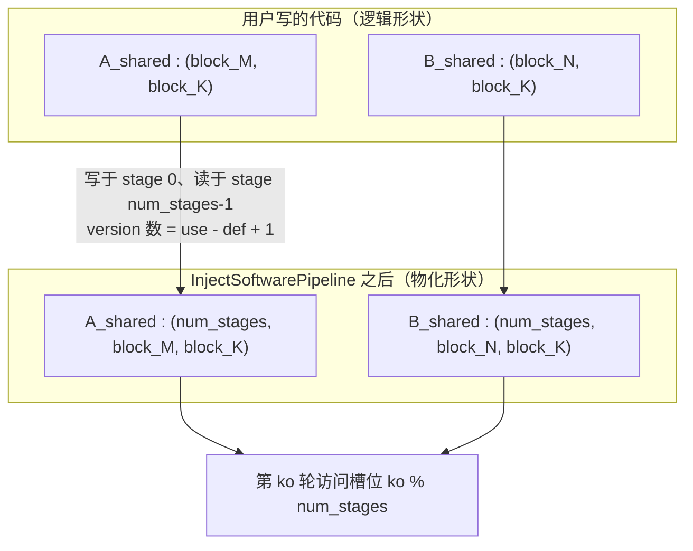

# 图 2：多缓冲的内存布局与槽位轮转

对应正文第 2.3、4.4 节。要点：流水在 IR 上的落地方式是**给被跨 stage 读写的 buffer
最外层加一个“版本”维**，把“一份 A tile”变成“num_stages 份 A tile”；每一轮
访问哪一份由 `iteration % num_stages` 决定。

## Mermaid 版本



## ASCII 版本

```text
用户写的一个 buffer                    编译期展开成 num_stages 个版本
┌───────────────────────┐            ┌──────────────────────────────────────────┐
│ A_shared              │            │ A_shared                                 │
│ shape (BM, BK)        │   ────►    │ shape (num_stages, BM, BK)               │
│ 一份 A tile 的字节     │            │ 槽位 0 | 槽位 1 | 槽位 2 | …             │
└───────────────────────┘            └──────────────────────────────────────────┘
                                     每轮写/读的是 A_shared[ko % num_stages]


槽位轮转（num_stages = 3，BM=BK=128、fp16、单份 A 是 32 KiB）

  ko=0        ko=1        ko=2        ko=3        ko=4        ko=5
  ┌──┐       ┌──┐       ┌──┐       ┌──┐       ┌──┐       ┌──┐
  │0 │写     │0 │读     │0 │读     │0 │写 ← 覆盖  │0 │读     │0 │读
  ├──┤       ├──┤       ├──┤       ├──┤       ├──┤       ├──┤
  │1 │      │1 │写     │1 │读     │1 │读     │1 │写 ← 覆盖  │1 │读
  ├──┤       ├──┤       ├──┤       ├──┤       ├──┤       ├──┤
  │2 │      │2 │       │2 │写     │2 │读     │2 │读     │2 │写 ← 覆盖
  └──┘       └──┘       └──┘       └──┘       └──┘       └──┘

  「写 ← 覆盖」这一格是关键：只有当上一轮的消费者已经读完，
  这一格才可以被重新写入。这就是同步（barrier / wait）要保证的事。

  整个 kernel 的片上占用 ≈ num_stages × (A tile 字节 + B tile 字节)
                           + 其它（barrier、累加器、stage 外分配的 buffer）
```

## 尺寸怎么变

`ComputeBufferVersions` 先做活跃期分析，得到每个 buffer 的“定义 stage”与“最后被
使用的 stage”，然后：

```text
num_versions = use_stage - def_stage + 1        （上界）
```

对于“stage 0 写、stage `num_stages - 1` 读”的典型 GEMM 体，
`num_versions = num_stages`。如果 buffer 只在同一个 stage 内被写后立即被读，
版本数会退化成 1 ，也就是**不做多缓冲**。

```text
stage 注解:   copy A -> stage 0    copy B -> stage 0
             gemm   -> stage num_stages-1

             def = 0, use = num_stages-1
             num_versions = num_stages

同一个 stage 内的 fill + gemm:
             def = 0, use = 0    ->  num_versions = 1  （不复制）
```

## 一步到位的容量估算

```text
每一份 A tile 的字节 = block_M × block_K × sizeof(dtype)
每一份 B tile 的字节 = block_K × block_N × sizeof(dtype)

GEMM 的片上占用上界 = num_stages × (A + B)

例子（fp16，即 2 字节/元素）：
   block_M = block_N = 128, block_K = 32, num_stages = 3
   A = 128×32×2 = 8192 B, B = 32×128×2 = 8192 B
   → 3 × 16384 = 49152 B = 48 KiB        （H100 上很容易放下）

   block_M = block_N = 256, block_K = 64, num_stages = 4
   A = 256×64×2 = 32768 B, B = 64×256×2 = 32768 B
   → 4 × 65536 = 262144 B = 256 KiB
     （超过 H100 每个 SM 的 228 KB 可配置 shared memory 上限）

可复算版本：code/02-shared-memory-budget/smem_budget.py
```

## 来源

* 版本维的插入与形状改写：
  `_vendor/tilelang-v0.1.15/src/transform/inject_pipeline.cc:1546-1560`
  （`RewriteAllocBuffer` 把新维度插到 `shape` 的最前面）。
* 版本数的算法：`_vendor/tilelang-v0.1.15/src/transform/inject_pipeline.cc:1474-1544`
  （`ComputeBufferVersions`）。
* stage/order 注解如何被自动推导：
  `_vendor/tilelang-v0.1.15/src/transform/pipeline_planning.cc:1160-1310`。
* 共享内存容量的硬上限（H100 每个 SM 的 shared+L1 共 256 KB，其中 shared 可配置到
  228 KB）：
  `../tilelang-corpus/05-nvidia-backend/raw/nvidia-blog-hopper-architecture-in-depth.md`。
* 合并与复用 shared 分配的 pass：
  `_vendor/tilelang-v0.1.15/src/transform/merge_shared_memory_allocations.cc:1576-1660`
  所以上面的乘积是**上界**，实际占用可能更小。
