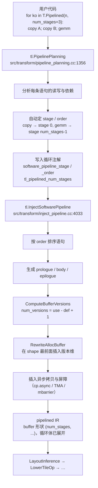

# 图 3：从 `T.Pipelined` 到多缓冲 IR 的编译期两步

对应正文第 4.1 节。要点：用户只写了一句 `T.Pipelined(..., num_stages=N)`，
编译器把它拆成两个 pass：**先规划（决定每条语句属于哪个 stage、按什么 order 发射），
再改写（把顺序循环变成 prologue / steady-state body / epilogue，并给 buffer 加版本维）**。

## Mermaid 版本



## ASCII 版本

```text
                      用户写的                       循环注解（pass 之间传递）
  ┌──────────────────────────────┐
  │ for ko in T.Pipelined(       │
  │     n, num_stages=3):        │
  │   T.copy(A[...], A_shared)   │        ┌──────────────────────────────────────┐
  │   T.copy(B[...], B_shared)   │        │ software_pipeline_stage = [0, 0, 2]  │
  │   T.gemm(A_shared, B_shared) │        │ software_pipeline_order = [0, 1, 2]  │
  └──────────────┬───────────────┘        │ tl_pipelined_num_stages = 3          │
                 │                        └──────────────────────────────────────┘
                 │                                        ▲
   ┌─────────────▼────────────────────────┐               │
   │ ① tl.PipelinePlanning                │───────────────┘
   │    pipeline_planning.cc:1356         │
   │  · 找语句的 use-def 与 buffer 依赖     │
   │  · 给 copy 类语句分配 producer stage   │
   │  · 给消费者分配 num_stages（再回落 1） │
   │  · 校验 order 唯一、生产者不晚于消费者 │
   └─────────────┬────────────────────────┘
                 │
   ┌─────────────▼────────────────────────┐
   │ ② tl.InjectSoftwarePipeline          │
   │    inject_pipeline.cc:4033           │
   │  · 按 order 重排语句                  │
   │  · prologue  EmitImpl(min, min+max_stage)
   │    body      EmitImpl(min+max_stage, min+extent)
   │    epilogue  EmitImpl(min+extent, min+extent+max_stage)
   │  · ComputeBufferVersions: 版本数      │
   │    = use_stage - def_stage + 1        │
   │  · RewriteAllocBuffer: shape 最前面   │
   │    插入版本维 → (num_stages, BM, BK)  │
   │  · 插入 cp.async / TMA / mbarrier     │
   └─────────────┬────────────────────────┘
                 │
   ┌─────────────▼────────────────────────┐
   │ LayoutInference → LowerTileOp → …    │
   │ （cuda/pipeline.py:129-142）          │
   └──────────────────────────────────────┘
```

## 为什么分成两步

* **规划**只做与目标无关的图分析：谁是生产者、谁是消费者、谁必须先于谁。它的产物是
  一组**注解**，仍然可以把 IR 打回原样观察（这也是第 12 章调试 `pass_diff` 的抓手）。
* **改写**才是不可逆的：它把循环拆成三段，把 buffer 复制成多份，并插入同步原语。
  一旦这一步跑完，你看到的就已经是“多缓冲后的机器形状”。
* 这个分工让“手动指定 `stage`/`order`”与“只给 `num_stages`”走同一条下游路径：
  前者由用户填注解，后者由 planner 填注解，`InjectSoftwarePipeline` 不认识区别。

## 来源

* 两步在 CUDA pipeline 中的位置：
  `_vendor/tilelang-v0.1.15/tilelang/cuda/pipeline.py:129-142`。
* `PipelinePlanning` 的实现与注册：
  `_vendor/tilelang-v0.1.15/src/transform/pipeline_planning.cc:1002-1310`、
  `:1356-1365`。
* `InjectSoftwarePipeline` 的实现与注册：
  `_vendor/tilelang-v0.1.15/src/transform/inject_pipeline.cc:1208-1265`、
  `:4033-4048`。
* `num_stages` 在注解里的读取顺序（`num_stages` → `tl_pipelined_num_stages` →
  `max(stage)+1`）：
  `_vendor/tilelang-v0.1.15/src/transform/common/pipeline_utils.h:74-110`。
* 昇腾侧对应的 pass 序列见 `_vendor/tilelang-v0.1.15/tilelang/ascend/pipeline.py:108-114`
  （`EstimateLatency → AutoSchedule → PrepareMultiBuffer → InsertSync →
  MaterializeMultiBuffer`），与 NVIDIA 侧不是同一套机制，见第 4.6 节。
