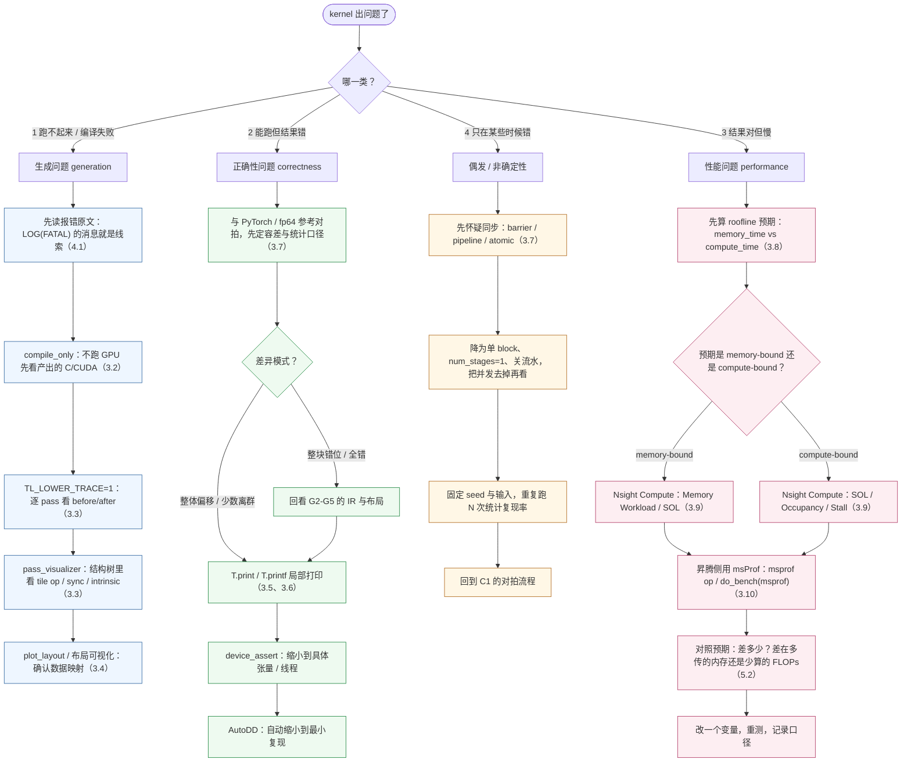

# 图 1：问题分类 → 工具 → 定位路径

对应正文 **2.3 节**。这张图是本章的总入口：先按「症状」把手上的问题分到四类之一，
再沿着该类对应的工具链往下走；每一格右侧标注了正文小节号。

要点：

* 四类问题**不是靠猜**，而是靠「有没有报错 / 结果对不对 / 快不快 / 稳不稳」四个可观测
  信号分出来的。
* 「偶发」这一类必须先怀疑同步：绝大多数偶发结果错误来自缺 `barrier`、pipeline 的
  缓冲区版本错误，或者多个 block 对同一地址的无序写（见正文 3.7）。
* 性能类一定要**先有 roofline 预期**再上 profiler，否则你只是在看一堆数字（见正文 3.8）。
* 本图不区分 NVIDIA / 昇腾；两侧工具的对应关系见正文 5.3 节的对照表。
