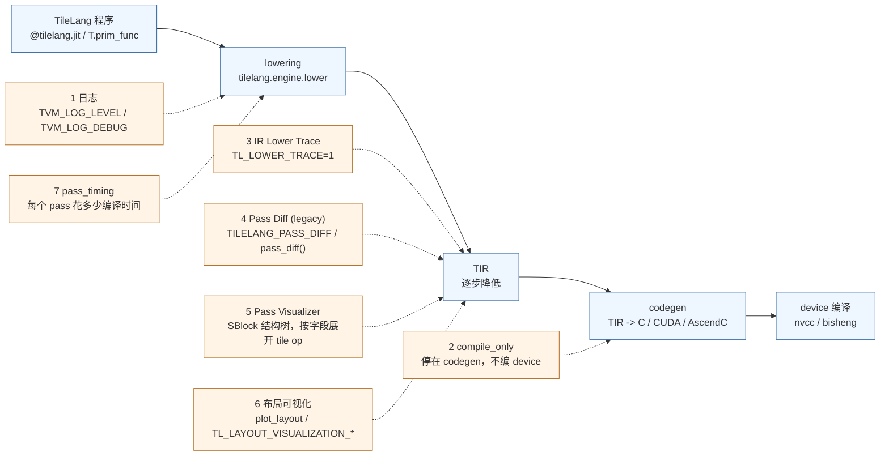

# 图 2：编译期工具的分层与产物

对应正文 **3.1–3.4 节**。同一个 lowering 过程，按“你想看哪一层”选不同的工具，
它们捕捉的粒度从粗到细。

对照表（哪些能离线跑、哪些必须上卡）：

| 工具 | 看什么 | 需要 GPU/NPU 吗 | 正文 |
| --- | --- | --- | --- |
| 日志 | C++ 侧的 `LOG` / `CHECK` 输出，定位编译器内部断言 | 否 | 3.1 |
| `compile_only` | lowering 产出的源码文本 | 否（CUDA 目标只需 codegen FFI） | 3.2 |
| IR Lower Trace | 每个 pass 文本 before/after，以及最终 codegen | 否（只做 lowering） | 3.3 |
| Pass Diff | 同上，legacy 接口 | 否 | 3.3 |
| Pass Visualizer | `SBlock` 结构树与 tile op 字段 | 否（CLI 目前只支持 CUDA 目标） | 3.3 |
| 布局可视化 | fragment 的 thread / local-index 映射 | 否 | 3.4 |
| `pass_timing` | 编译期各 pass 耗时（不是运行期性能） | 否 | 3.3 |

要点：

* **编译期工具都不需要加速器**（除 `pass_visualizer` 的 CLI 目前只覆盖 CUDA 目标）。
  这就是“没有卡也能做前面一半调试”的底气。
* “编译期性能”和“运行期性能”是两件事：`pass_timing` 测的是编译器自己花了多久，
  不是你的 kernel 跑得多快。不要混用。
