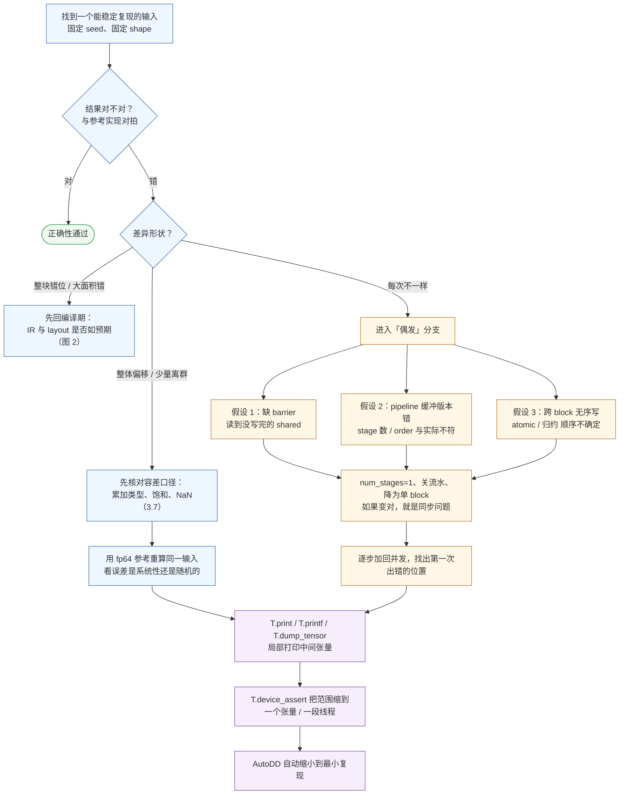

# 图 3：运行期调试路径（含偶发错误）

对应正文 **3.5–3.7 节**。「能跑但结果错」这一类，标准流程是先对拍、再按差异模式分流，
最后才动用打印。**打印是核武器，不是第一手段**——它会改变 kernel 的时序与性能。

要点：

* 「先在 CPU 上把参考算对，再上卡跑 kernel」永远比反过来便宜。
* 偶发错误的排查顺序是**先去掉并发，再加回并发**，而不是直接读代码找 bug。
* 昇腾侧没有 CUDA 的 device `printf` 语义；主动打印用 `T.printf` / `T.dump_tensor`
  （每个核 1 MB 上限），事后取现场用 AICore 异常 dump（见正文 3.6、4.5）。
