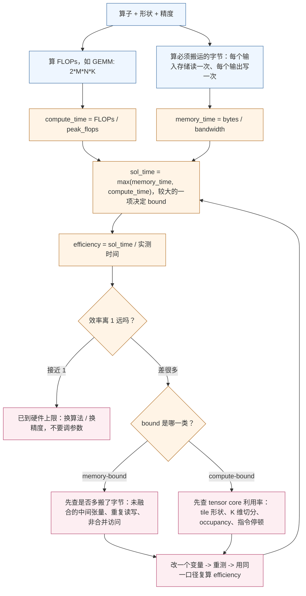

# 图 4：先建立 roofline 预期，再测量

对应正文 **3.8–3.10 节**。性能分析最常见的浪费是「先测一堆数，再想它意味什么」。
正确顺序是先算出这个算子的理论上下界，再用 profiler 回答「差在哪一项」。

要点：

* `bytes` 用的是**算法最小搬运量**（每个输入存储读一次、每个公开输出写一次），
  不是 profiler 测到的 DRAM 流量。两者之差本身就是「多搬了」的证据。
* TileLang 自带的 `tilelang.tools.Analyzer` 就是这个流程的静态实现：它数 `T.gemm`
  的 FLOPs、数 `T.copy` 跨 global 边界的字节，返回 `total_flops` /
  `total_global_bytes` / `estimated_time`。它是**估算**，不是实测。
* 昇腾侧的 pipe 利用率（AIC 的 mad/mte1/mte2/fixpipe，AIV 的 vec/mte2/mte3）
  不能相加成一个「总利用率」——它们分母各自不同（见正文 5.2）。
