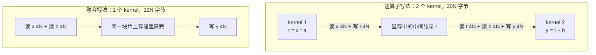

# 图 01 · 融合的访存账本

以 `y = x * a + b`（`x`、`b`、`y` 都是长度 N 的 fp32）为例。



同一台机器上，账本上的下界变成：

```text
逐算子：bytes = 20N   flops = 2N   AI = 0.100 FLOP/Byte
融合  ：bytes = 12N   flops = 2N   AI = 0.167 FLOP/Byte
比值  ：20N / 12N = 1.67×
```

归一化类算子差距更大，因为它们要多读一遍输入才能算均值：

```text
RMSNorm  逐算子 6 步：235.0 MB   →  融合 1 个 kernel：67.1 MB   （3.50×）
LayerNorm 多趟分解 ：335.6 MB   →  融合 1 个 kernel：67.1 MB   （5.00×）
RoPE      4 步分解：369.1 MB   →  融合 1 个 kernel：100.7 MB  （3.67×）
RMSNorm+RoPE+FP8 量化：185.6 MB →  融合 1 个 kernel：51.4 MB    （3.61×）
```

（数字来自 `code/01-ledger/ledger.py`，形状取 4096×4096、RoPE 取 4096 token × 32 head
× rope_dim 128。这是**模型**，不是测量。）

**来源**：第 02 章 §2.1 的记账口径；本图数字由
`code/01-ledger/ledger.py` 复算得到。

**边界**：所有数字都是下界。真实 kernel 还要加上 cache 未命中、kernel 启动、
尾部效应与同步开销；融合也会因为片上容量不足而被迫缩小 tile。
