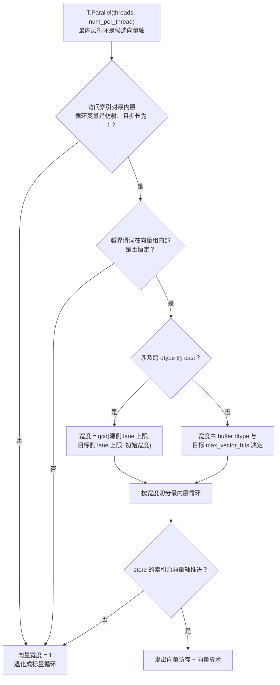

# 图 02 · 一个逐元素循环为什么没被向量化



官方 elementwise 文档给的对照实验：`N = 2047`、`threads = 256`、
每线程 8 个元素时，生成的 CUDA 是

```c++
#pragma unroll
for (int i = 0; i < 8; ++i) {
  if (((i * 256) + ((int)threadIdx.x)) < 2047) {
    C[...] = A[...] + B[...];
  }
}
```

——没有 `uint4`，没有合并访存，因为尾块的谓词让「向量组内部恒定」不成立。
把 N 换成 2048（整除）之后，同一段代码生成的是 `uint4` 的 128-bit 访存。

**来源**：`../tilelang-corpus/01-tilelang-official-docs/raw/site/_sources/deeplearning_operators/elementwise.md:104-133,153-176`；
判定链对应 `_vendor/tilelang-v0.1.15/src/transform/loop_vectorize.cc:1016-1066`
（`ComputeBufferVectorSize`）与 `:1248-1281`（`IsExprInvariantInVectorBoundary`）、
`:966-1000`（cast 的 lane 上限）；
越界谓词的插入在 `_vendor/tilelang-v0.1.15/src/transform/legalize_safe_memory_access.cc:419-477`。

**边界**：上图是从源码读出的判定**顺序与依据**，不是实际编译 trace。具体某个 kernel
最终取了多大的向量宽度，要用 `kernel.get_kernel_source()` 看生成代码（第 12 章）。
