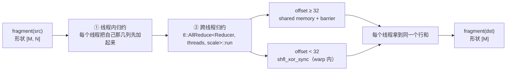

# 图 03 · `T.reduce_sum` 的两段归约与 `clear` 语义



`clear` 决定的是「行和要不要和 dst 里已有的值合并」：

```text
clear = True （默认）
    → 直接归约，结果覆盖 dst

clear = False
    → 先把 dst 拷进一个临时 fragment
    → 再以 clear=False 归约
    → 最后把临时值加回去
      dst_new = dst_old ⊕ reduce(src)
```

这就是为什么 `clear=False` 的 sum/abssum 会**多分配一份临时 buffer**：
跨线程归约是 butterfly，如果把 dst 直接当累加器，同一个值会在每一级里被重复计入。

三个 scope 分支（v0.1.15 前端就会替你把中间 fragment 建好）：

| src scope | dst scope | 前端做了什么 |
| --- | --- | --- |
| shared | shared | 建两个 fragment，`copy` 进、归约、`copy` 出 |
| shared | fragment | 建一个 fragment，`copy` 进、归约 |
| fragment | shared | 建一个 fragment 承接结果，归约后 `copy` 出 |
| fragment | fragment | 直接发射 `tl.tileop.reduce` |

**来源**：`_vendor/tilelang-v0.1.15/tilelang/language/reduce_op.py:94-171`（scope 分支与
`clear` 处理）、`:230-259`（`reduce_sum` 的 `clear` 说明）、
`_vendor/tilelang-v0.1.15/src/op/reduce.cc:168-198`（lowering 的行为说明）、
`_vendor/tilelang-v0.1.15/src/tl_templates/cuda/reduce.h:211-253,279-296`
（`AllReduce` 的两条路径与四条 `static_assert`）。

**约束**：`threads` 必须能被 `scale` 整除，且 `threads / scale` 是 2 的幂。
昇腾侧的 `T.reduce_*` 是另一套实现（适配器版本还多 `real_shape` / `tmp` 参数）。
