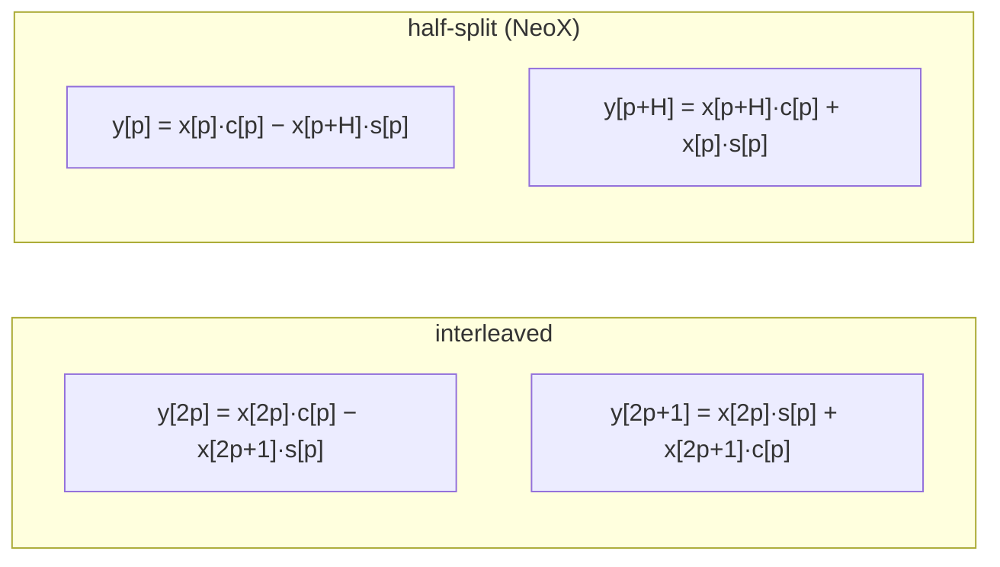

# 图 04 · RoPE 的两种配对约定

同一个 8 维向量，两种约定配对方式不同，**结果也不同**：

```text
interleaved（原版 RoFormer / non-neox）       half-split（NeoX / Llama / Qwen）
索引： 0 1 2 3 4 5 6 7                       索引： 0 1 2 3 │ 4 5 6 7
        └─┘ └─┘ └─┘ └─┘                              └─────────┘ └─────────┘
        (0,1) (2,3) (4,5) (6,7)                      (0,4) (1,5) (2,6) (3,7)
```



（`H = R/2`，`cos/sin` 表的形状是 `(seq_len, R/2)`：**一个 pair 一行**。）

两种约定对访存的影响：

```text
half-split : 一次循环读 x[i, p] 与 x[i, p+H]
             → 两条 store 的索引步长都是 1，各自可向量化
interleaved: 一次循环读 x[i, 2p] 与 x[i, 2p+1]
             → 按 pair 循环时两条 store 的步长都是 2，散访
             → 正确做法是按 128-bit 向量读整行（一对元素落在同一向量里）
```

**来源**：`_vendor/tilelang-ascend-v0.1.2.000/examples/pos_embedding/rope.py:132-150`
（interleaved 的 PyTorch 参考实现与 `[-x1, x0]` 注释）；
`../tilelang-corpus/12-operator-libraries/raw/TileOPs/src/tileops/kernels/rope.py:1-20`
（两种约定的命名与适用模型）。

**边界**：错误只体现在数值上，两种约定都能跑完，不会报错，也不会崩。
这也是本章把“先对齐 PyTorch 参考实现”放在第一位的原因。
