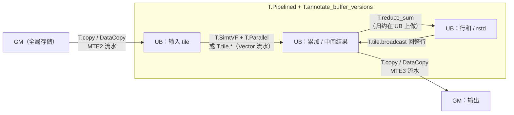

# 图 05 · 昇腾上一次「逐元素 + 归约」的 UB 用法



三个和 CUDA 侧不同的点：

```text
① 片上存储只有一个名字：UB
   主干 v0.1.15    T.alloc_shared(...)        ← 在昇腾侧就是 UB
   适配器 v0.1.2.000 T.alloc_ub(...)          ← 主干没有这个 API

② 线程域要显式声明
   主干          with T.SimtVF(threads=N):  内部 T.Parallel 才向量化
   适配器        with T.Scope("V"):         配合 T.barrier_all() 手工同步

③ tile 大小由 UB 容量反向决定
   CUDA 上 shared memory 超了可以靠 L1 兜底；
   UB 是固定的一块，放不下就得减 tile 或减缓冲份数。
```

**来源**：`_vendor/tilelang-v0.1.15/tilelang/ascend/language/allocate.py:15-23`
（`alloc_shared` = UB）、`_vendor/tilelang-v0.1.15/tilelang/ascend/language/frame.py:107,179`
（`SimtVF` / `SimdVF`）、`_vendor/tilelang-v0.1.15/examples/ascend/example_rmsnorm.py:17-84`
（UB 预算、`rows` 挑选、`annotate_buffer_versions`）；
适配器侧见 `_vendor/tilelang-ascend-v0.1.2.000/tilelang/language/allocate.py:156`。

**边界**：图里画的是**数据流方向**，不是硬件流水线的时序图。真实调度由 Ascend 的
同步 pass 与 `T.Pipelined` 决定，本图不含任何延迟或带宽数字。
