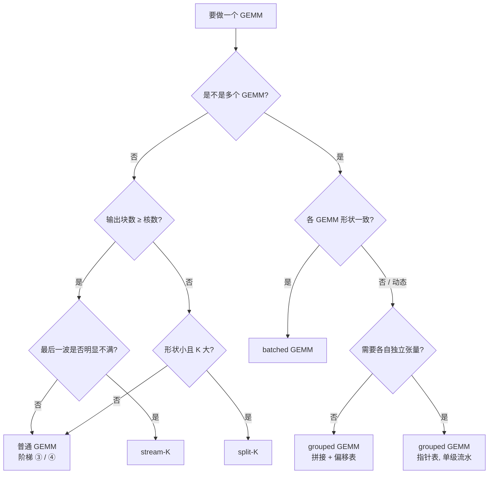

# 图 4：GEMM 变体家族的选择判断树

**用途**：正文第 4.5 节。



## 四个变体的“账”对照

```text
变体        读入量            写出量              额外开销         解决的问题
普通 GEMM   MNK(1/m+1/n)     MN                ——               并行度足够
split-K     MNK(1/m+1/n)     MNK/k  (×split_k) 原子合并         输出块数 < 核数
stream-K    同普通            同普通 + 被切块    workspace/fixup   尾波量化
grouped     各专家之和        Σ M_g·N           偏移表/间接寻址   形状各异 (MoE)
batched     同普通 × batch    同普通 × batch     ——               形状一致
```

来源：R3（CATLASS 的 MultiCoreSplitK 模板给出读入量不变、写出量
$MNK/k$ 的结论）、S22–S24、S28、A4、R7。
