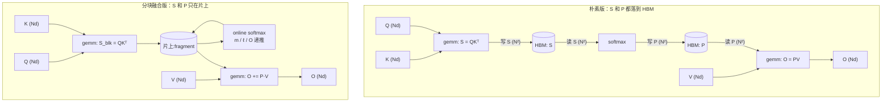

# 图 1：朴素 attention 的三趟访存 vs. 分块融合的一趟

对应正文第 1.2–1.3、2.5 节。要点：**瓶颈不是 `O(N²d)` 的乘加，而是 `O(N²)` 的中间
结果在 HBM 上来回。** 图里的所有数字都来自 `code/01-traffic-model/traffic_model.py`
的模型（`Sq = Skv = 8192, d = 128, block_m = block_n = 128, fp16`），是**元素个数**，
不是测量。

## Mermaid 版本（数据流）



## ASCII 版本

```text
（1）朴素版：每个 (batch, head) 搬 4·N² + 4·N·d 个元素

      Q ──┐
          ├─► [ S = QKᵀ ] ─► 写 S (N²) ─┐
      K ──┘                             │
                              [ softmax: 读 S (N²) ] ─► 写 P (N²) ─┐
                                                                    │
      V ──┐                                                         │
          └─► [ O = PV ] ◄──── 读 P (N²) ───────────────────────────┘
                  │
                  └─► 写 O (N·d)

      N = 8192 时：S write 67,108,864 + S read 67,108,864
                   P write 67,108,864 + P read 67,108,864   = 2.68e8
                   Q/K/V/O 一共只有 4.19e6 —— 占 1.5%


（2）分块融合版：S/P 一次都不出片上，代价是 K/V 每个 Q 块重读一次

      对每个 Q 块（共 N/block_m = 64 个）：
          读 Q_blk (block_m·d)
          for 每个 KV 块（共 N/block_n = 64 个）：
              读 K_blk ─┐
              读 V_blk ─┴─► 片上算 S_blk、做 online softmax、算 O += P·V

      总流量 = Q(1) + K(64) + V(64) + O(1) = 1.36e8 个元素
      其中 N² 项为 0

      ┌────────────────────────────┬──────────────┬──────────────┐
      │ 项目                       │ naive        │ tiled        │
      ├────────────────────────────┼──────────────┼──────────────┤
      │ S/P 的读写（4N²）           │ 268,435,456  │ 0            │
      │ K/V 重读                    │ 0            │ 134,217,728  │
      │ Q/O + 单次 K/V              │ 4,194,304    │ 2,097,152    │
      │ 合计（元素）                │ 272,629,760  │ 136,314,880  │
      │ 倍数                        │ 2.00x        │ 1.00x        │
      └────────────────────────────┴──────────────┴──────────────┘


（3）同一个模型在 decode 形状（Sq = 1, Skv = N）下给出的答案完全不同

      Sq = 1 时朴素版的 S 只有 1×N，不是 N×N：

        N       naive        tiled     ratio
        512     133,376      131,328      1x
        8192    2,130,176    2,097,408    1x

      → decode 的瓶颈不是流量，是并行度：只有一行 query，
        一个 block 就干完了。这就是 split-KV 要存在的原因（第 5.4 节）。
```

## 读图要点

1. **三趟变一趟**指的是 `S`/`P` 的落地次数，不是 K/V 的读取次数。优化之后 K 和 V
   反而**被读得更多**（每个 Q 块都要读一遍），用带宽换片上空间。
2. **“省”与“不省”取决于形状。** prefill（`Sq = Skv = N`）省得多；decode
   （`Sq = 1`）根本不省。把这两件事混为一谈，就会得出“decode 也该用同一个 kernel”
   这种错误结论。
3. 图上 `2.00x` 这个倍数**只属于这个模型**。模型忽略了 `N×N` 在 SRAM 里根本放不下、
   忽略了缓存与 TMA，也忽略了实际 kernel 里的软硬件重叠。真实收益需要实测，
   本章不做任何性能承诺。

## 来源

* 全部数字：本章 `code/01-traffic-model/traffic_model.py`（纯标准库，可复算）。
* “IO-aware exact attention”的定性表述：
  `../tilelang-corpus/03-tilelang-papers/raw/arxiv-2205-14135.md`（FA1 摘要）。
* 本文与图中不含任何硬件实测数据。
