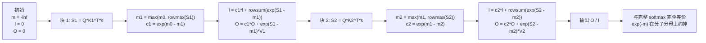

# 图 2：online softmax 的状态递推

对应正文第 2.2–2.4 节。要点：**每处理一块 key，只需要维护三个每行一个的状态
（运行最大值 `m`、分母 `ℓ`、未归一化分子 `O`），重标度因子永远是 `exp(m_prev − m_new) ∈ (0, 1]`。**

## Mermaid 版本（状态机）



## ASCII 版本

```text
（1）一次状态更新，逐项对应公式与代码

      输入：当前块 S_blk = Q_blk · K_blkᵀ （尚未缩放）

    ①  M = rowmax(S_blk)             kernel: T.reduce_max(acc_s, scores_max, dim=1)
    ②  m_new = max(m_prev, M)        scores_max[i] = T.max(scores_max[i], scores_max_prev[i])
    ③  c = exp(m_prev − m_new)       scores_scale[i] = T.exp2(m_prev·scale − m_new·scale)
                                      （因为 m_new ≥ m_prev，所以 0 < c ≤ 1）
    ④  P = exp(S_blk − m_new)        acc_s[i,j] = T.exp2(acc_s[i,j]·scale − m_new·scale)
    ⑤  ℓ = c·ℓ + rowsum(P)           logsum[i] = logsum[i]·scores_scale[i] + scores_sum[i]
    ⑥  O = c·O + P·V_blk             acc_o[i,j] *= scores_scale[i]; T.gemm(acc_s_cast, V_shared, acc_o)

      c 把「旧累加器」和「新块」换算到同一个 m 上；最终比值里 exp(−m) 会被消掉，
      所以 m 取大取小、什么时候更新，都不改变结果。


（2）递推轨迹（来自 code/02 第 1 段，fp64）

      块号   m（运行最大）   c = exp(m_prev − m)   ℓ（分母）     max|O|
      ---------------------------------------------------------------
        0       1.500000          0.000000         2.028371   1.255805
        1       1.500000          1.000000         2.836150   2.556749
        2       1.500000          1.000000         4.285457   6.226913

      第 0 块的 c = 0：m_prev 还是 −∞，旧的（空的）累加器被清零，这是对的。
      第 1、2 块的 c = 1：最大值没有再变大，旧状态不需要重标度。


（3）两条边界（正文第 5.1 节）

      a) 某一行的所有分数都被 mask 掉：
             m_prev = −∞, m_new = −∞  →  c = exp2(−∞ − (−∞)) = exp2(NaN) = NaN
         于是 acc_o 被 NaN 污染。官方例子的修法（check_inf，
         attention_sink 例子的 :103-109）：
             if scores_max[i] == −inf:  scores_max[i] = 0
         →  c = exp2(−∞ − 0) = 0，该块贡献 0，不再产生 NaN。

      b) 整行到最后都没有任何可见 key：
             ℓ = 0  →  O / ℓ = 0/0 = NaN
         check_inf 修不了这个（它只处理「这一块为空」）。官方 varlen 例子
         显式守卫（example_gqa_fwd_varlen.py:117-119）。
```

## 读图要点

1. **只有加法与乘法。** 没有任何一步需要回头重算前面，这就是“一趟”的全部含义。
2. **`m` 是数值装置，不是数学对象。** 图里 `c = 0` 与 `c = 1` 都是合法取值；
   把 `m` 固定成常量（例如 0）结果在数学上仍然相同，只是中间量会溢出。
   正文 2.4 节的归纳证明说的就是这件事。
3. **同一个技巧会用两次**：KV 方向的分块（这里），以及 split-KV 的段间合并
   （见第 5.4 节，那里把它用在了 LSE 上）。

## 来源

* 轨迹与全部数字：本章 `code/02-online-softmax/online_softmax.py` 的输出（CPU、fp64）。
* `check_inf` 的写法：
  `_vendor/tilelang-v0.1.15/examples/attention_sink/example_mha_sink_fwd_bhsd.py:103-109`。
* “空行”守卫：
  `_vendor/tilelang-v0.1.15/examples/flash_attention/example_gqa_fwd_varlen.py:117-119`。
* 本图不含任何硬件实测数据。
