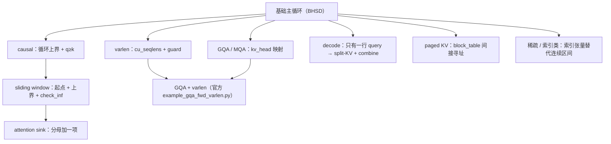

# 图 4：attention 变体矩阵

对应正文第 4.6–4.7、5.2–5.5 节。要点：**把「变体」还原成「主循环上的哪一行不同」。**
所有路径都在锁定版本里核对过；行号由 `code/05`、`code/06` 两个脚本打印。

## ASCII 版本

```text
                                  ┌──────────────┐
                                  │ 基础主循环    │
                                  │ Q,K,V → O    │
                                  └──────┬───────┘
        ┌───────────────┬────────────────┼────────────────┬───────────────┐
        │               │                │                │               │
   ① loop_range     ② mask           ③ head 映射      ④ 输出写回      ⑤ 索引来源
        │               │                │                │               │
   causal:         causal:          GQA/MQA:         varlen:         paged KV:
   上界裁到          q_idx>=k_idx    kv_head =        cu_seqlens      block_table
   最大 q 行        window:          head//groups     前缀和 +        间接寻址
                   下界+上界双裁                       guard

   ⑥ 分母                 ⑦ KV 遍历长度
   sink: epilogue         decode: KV 切成 num_split，
   多加 exp(sink−m)       再加一个 combine kernel


变体 → 官方案例 → 改了哪一行
┌──────────────┬────────────────────────────────────────────┬───────────────────────────────┐
│ 变体          │ 锁定版本里的实现                            │ 关键改动                        │
├──────────────┼────────────────────────────────────────────┼───────────────────────────────┤
│ 基础 MHA BHSD │ examples/flash_attention/                  │ 图 3 的 (1)–(5)                │
│              │   example_mha_fwd_bhsd.py                  │                               │
│ 基础 MHA BSHD │ examples/flash_attention/                  │ 索引顺序 [b,s,h,d]              │
│              │   example_mha_fwd_bshd.py                  │                               │
│ causal       │ 同上，is_causal=True                        │ 循环上界 + q>=k mask            │
│ GQA / MQA    │ example_gqa_fwd_bshd.py /                  │ kv_head_idx = head_idx//groups │
│              │   example_gqa_fwd_varlen.py                │ KV 头数 = heads//groups        │
│ varlen       │ example_mha_fwd_varlen.py /                │ cu_seqlens_q/k + max_seqlen_q  │
│              │   example_gqa_fwd_varlen.py                │ + 越界 guard                   │
│ decode       │ examples/flash_decoding/                   │ split kernel + combine kernel  │
│ (split-KV)   │   example_mha_inference.py                 │ 中间态：Output_partial + glse  │
│ paged KV     │ (昇腾) examples/flash_attention/            │ block_table 间接寻址            │
│              │   paged_flash_attn_bhsd.py                 │                               │
│ sliding      │ examples/attention_sink/                   │ 循环起点 + 上界裁剪 + check_inf │
│ window       │   example_mha_sink_fwd_bhsd.py             │                               │
│ sink         │ 同上，Sinks 输入                            │ 分母加 exp2(sink − m·scale)     │
│ block-causal │ examples/block_causal_attention/           │ 逐 tile 决定 mask / 只看对角线  │
│              │   block_causal_attention.py                │                               │
└──────────────┴────────────────────────────────────────────┴───────────────────────────────┘

（昇腾侧另有同构的一套，见正文 4.7 节与 code/06 的输出。）
```

## 变体之间的依赖关系



## 读图要点

1. **变体不是重写 kernel，而是在主循环上改一处。** 表格右列就是那一处。
2. **`GQA + varlen` 是两个变体的组合**，官方案例里它就是
   `example_gqa_fwd_varlen.py`；组合不会产生新的数学，只会产生新的索引与 guard。
3. **decode 是唯一改变了 kernel 数量的变体**（split + combine 两个 kernel），
   原因是它的瓶颈是并行度而不是流量（见图 1 的第 3 段）。
4. **稀疏/索引类是唯一改变了「KV 从哪来」的变体**：地址不再是 `k * block_N`，
   而是「查索引表」。这也是第 16 章的起点。

## 来源

* 所有文件路径：锁定版本 `_vendor/tilelang-v0.1.15/examples/` 与
  `_vendor/tilelang-ascend-v0.1.2.000/examples/`；逐条行号见
  `code/05-official-example-map/` 与 `code/06-ascend-map/` 的输出。
* causal 边界、window/sink、varlen、split-KV 的数值行为：
  `code/04-block-flash-attention/` 与 `code/03-split-kv-combine/` 的输出。
* 本图不含任何硬件实测数据。
