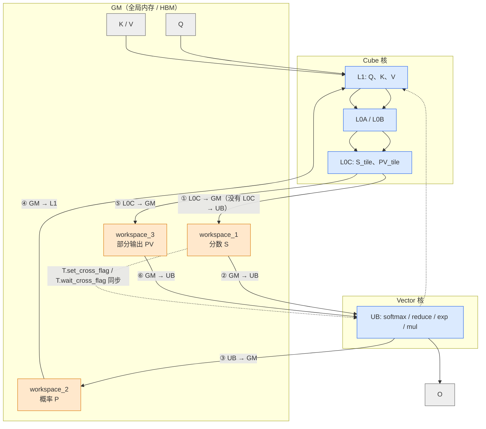

# 图 5：昇腾上 attention 的 Cube / Vector 数据通路

对应正文第 4.5、5.6 节。要点：**`QKᵀ` 的结果落在 L0C，而 softmax 只能由 Vector 核在
UB 上做；这两者之间没有直接的搬运通道，所以必须绕一趟全局内存（workspace）。**

## Mermaid 版本



## ASCII 版本

```text
锁定版编程指南列出的合法搬运对（docs/TileLang-Ascend Programming Guide.md:629-636）：

    GM  → L1        GM  → UB        UB  → L1       UB  → UB
    L1  → L0A       L1  → L0B       L0C → GM       UB  → GM

    注意 L0C 只有一条出边：L0C → GM。没有 L0C → UB。


于是 flash attention 在昇腾上的主循环变成：

   ┌──────────── Cube 核 ─────────────┐   ┌────────── Vector 核 ──────────┐
   │ Q·Kᵀ        → L0C                │   │                               │
   │            ↓ ① L0C → GM          │   │                               │
   │        (workspace_1)             │──►│ ② GM → UB                     │
   │                                  │   │   m = reduce_max(scores)      │
   │                                  │   │   m = max(m, m_prev)          │
   │                                  │   │   c = exp(m_prev − m)         │
   │                                  │   │   P = exp(scores − m)         │
   │                                  │   │   ℓ = c·ℓ + reduce_sum(P)     │
   │                                  │   │   O = c·O                     │
   │                                  │   │ ③ UB → GM (workspace_2)       │
   │ ④ GM → L1 → L0A/L0B              │◄──│   P（fp16）                   │
   │ P·V      → L0C (workspace_3)     │   │                               │
   │ ⑤ L0C → GM                       │   │ ⑥ GM → UB                     │
   │                                  │──►│   O += PV                     │
   │                                  │   │   O /= ℓ   → 写回 O           │
   └──────────────────────────────────┘   └───────────────────────────────┘
            ▲                                          │
            └────── cross-core flag / barrier ◄────────┘


两台机器上的瓶颈因此不同：

   NVIDIA                                   昇腾
   ─────────────────────────────────        ─────────────────────────────────
   Q·Kᵀ 直接累加到 fragment（寄存器）        Q·Kᵀ 落在 L0C，必须绕 GM 才能给 Vector
   主要矛盾：异步搬运与计算的重叠             主要矛盾：Cube 与 Vector 的核间流水、
             + 非矩阵指令的占比                       跨核同步次数、scalar 指令下发数
   优化手段：TMA / cp.async / warp           优化手段：L1 常驻、核内 Double Buffer、
             specialization、低精度                   最佳 num_stages、减少同步次数、
                                                       把 scalar 循环向量化成 tile 操作
```

## 读图要点

1. **一次 `T.copy` 可能不止一跳。** 前端写 `T.copy(acc_s_l0c, acc_s_ub)` 很自然，
   但在昇腾上它必须落到 `L0C → GM → UB` 两条指令上；主打仓库的编程指南 4.1.5.2 节
   说明编译器有一个专门的 pass 做这件改写。
2. **workspace 不是「调试用的临时缓冲」，而是数据通路的一环。**
   适配器版例子把它写成显式的 `workspace_1/2/3` 参数（`flash_attn_bhsd.py:26-34`）。
3. **同步是主要成本。** 每个 KV 块至少要两次跨核同步；把手写版与自动流水版对比，
   厂商自报的差异里有很大一块来自「减少核间同步下发次数」与「`T.pipelined` 开启
   核间 CV 流水」（见 `fa_opt/bench_mark_zh.md`；**厂商自报，作者未复现**）。
4. 图上**没有**任何带宽/延迟数字，因为写作环境没有 NPU。所有结构关系都来自锁定版本的
   代码与文档文本。

## 来源

* 搬运关系表：`_vendor/tilelang-ascend-v0.1.2.000/docs/TileLang-Ascend Programming Guide.md:629-636`
  （由 `code/06-ascend-map/ascend_attention_map.py` 解析打印）。
* workspace 与跨核 flag：
  `_vendor/tilelang-ascend-v0.1.2.000/examples/flash_attention/flash_attn_bhsd.py:26-34,86-131`。
* 自动 workspace 消除：
  同指南 `:1345-1390`（4.1.5.2 节）。
* 昇腾侧调优手段与收益：
  `_vendor/tilelang-ascend-v0.1.2.000/examples/flash_attention/fa_opt/flash_attention_performance_optimization_zh.md`
  与同目录 `bench_mark_zh.md`（**厂商自报，作者未复现**）。
* 主干仓库的昇腾 FA 与性能表：
  `_vendor/tilelang-v0.1.15/examples/ascend/flash_attention/README.md`
  （**厂商自报，作者未复现**）。
* 本图不含任何硬件实测数据。
