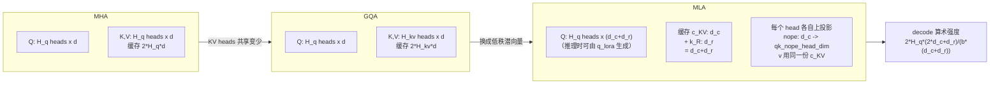

# 图 · MHA → GQA → MLA 与 KV 预算



```text
KV 预算（fp16，每 token 每层；DeepSeek-V3.2: H_q=128, d_c=512, d_r=64）
------------------------------------------------------------------------
MHA   128 heads x 128 dim : 2*128*128*2 = 65536 字节
GQA   8   kv-heads x 128  : 2*8*128*2   =  4096 字节
MLA   c_KV(512) + k_R(64) : (512+64)*2  =  1152 字节   （MHA 的 1.76%）
------------------------------------------------------------------------
decode 算术强度：MHA 1.0 / GQA-8 16.0 / MLA 241.8 FLOP/Byte
（H100 公开规格的平衡点约 333 FLOP/Byte）
```

注意：图示的 `d_c`、`d_r` 就是配置里的 `kv_lora_rank` 与 `qk_rope_head_dim`；
`qk_nope_head_dim`、`v_head_dim` 是每个 head 各自的上投影宽度，**不进** KV cache。
