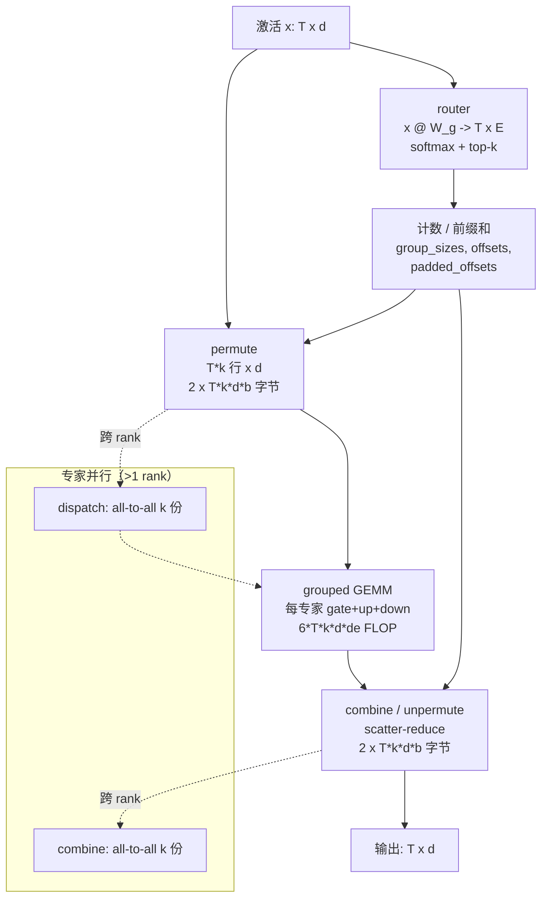

# 图 · MoE 一层的数据流



```text
每 token 的账（b = 每元素字节数）
--------------------------------------------
router      : 2*T*d*E FLOP          （很小，GEMV 形状）
permute     : 2*k*d*b 字节/token    （零 FLOP）
grouped GEMM: 6*k*d*de FLOP/token   （gate+up+down，各 2*k*d*de）
combine     : 2*k*d*b 字节/token    （零 FLOP）
EP dispatch :   k*d*b 字节/token    （网络）
EP combine  :   k*d*b 字节/token    （网络）
--------------------------------------------
重排 + 通信 = (4*k*d*b) 字节/token，全部不是矩阵乘。
```

依据：`_vendor/tilelang-v0.1.15/examples/fusedmoe/example_fusedmoe_tilelang.py`
（routed kernel 与 `scatter_reduce`）、
`_vendor/tilelang-ascend-v0.1.2.000/examples/dispatch_combine/dispatch_combine_shmem.py`
（shmem put 的 dispatch/combine 一对 kernel）。
