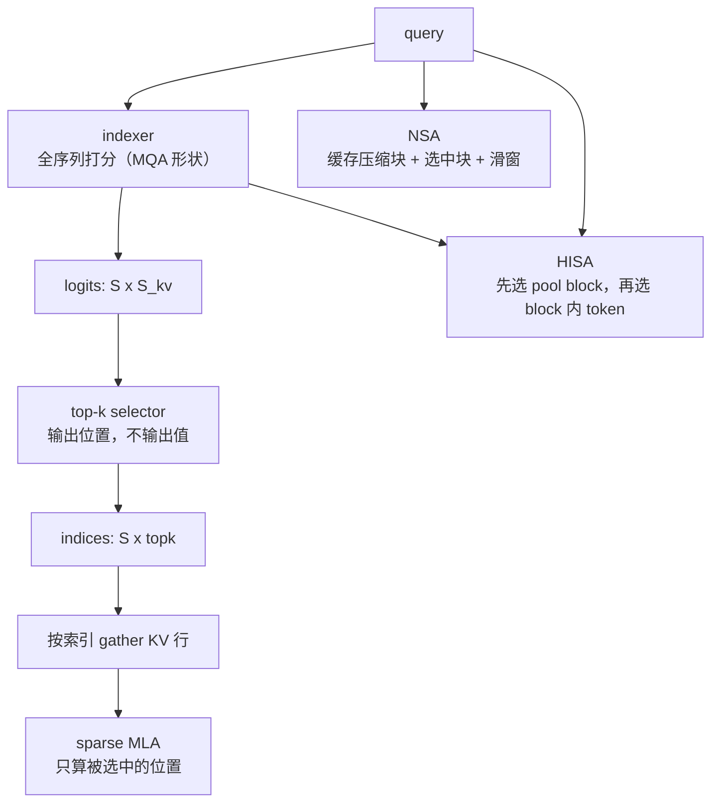

# 图 · 稀疏/索引算子的关系



```text
三条路线，一个共同点：把「读完整 KV」换成「读索引 + 读少量 KV」。
  NSA  : 输入是 block 索引，kernel 按块 gather
  DSA  : indexer 出 logits -> top-k 出位置 -> sparse MLA gather
  HISA : 两级层级，粗选 block 再细选 token
代价  : indexer 要扫全序列；L 很长时它的 FLOP 可以超过被它选中的 attention
       （见 code/05-sparse-index-map/sparse_index_map.py 的盈亏平衡表）。
```

依据：`_vendor/tilelang-v0.1.15/examples/{deepseek_nsa,deepseek_v32,dsa_hisa}/`。
