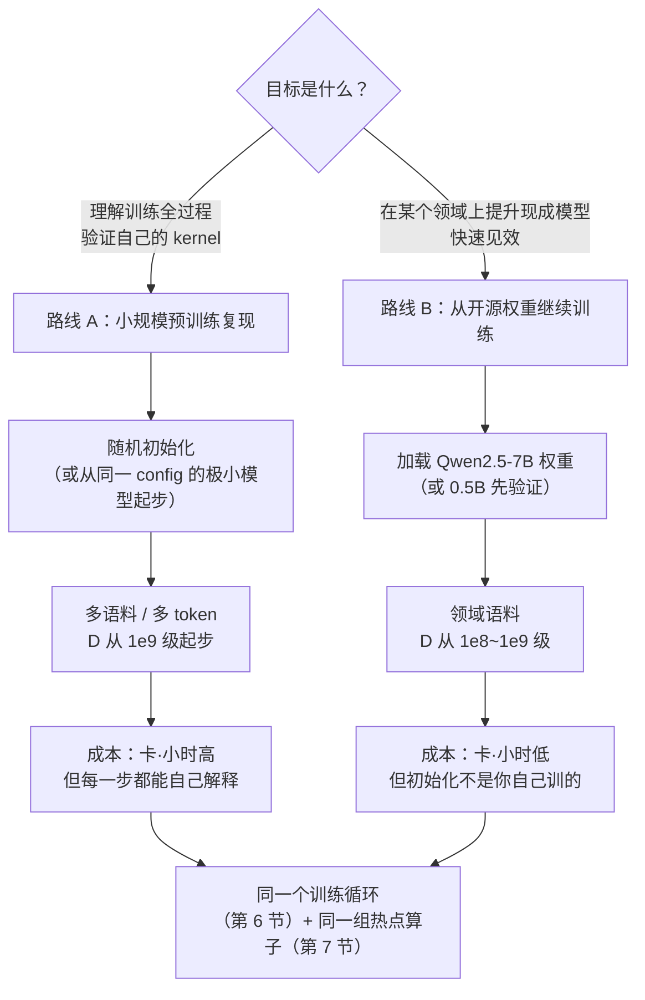

## 图 1 · 两条“从零训练”路线

对应正文 §3。左路是**预训练小规模复现**（自己从随机初始化训到底），右路是
**从开源权重继续训练**（continue pretraining / 领域适配）。两者共用一个训练循环，
差别在初始化、数据规模和成本模型。

**读图要点**

* 两条路线在“训练循环”和“算子替换点”上完全重合，所以本教材用同一套代码骨架。
* 真正的分水岭是 `D`（训练 token 数）：路线 A 想看到下游指标变化，`D` 至少要
  到百亿量级；路线 B 在十亿级就可能有可见的领域适配效果。
* 无论哪条路，**7B 的全量 Adam 训练在单卡上都装不下**（见正文 §2 账本），
  所以都从更小的模型起步。
