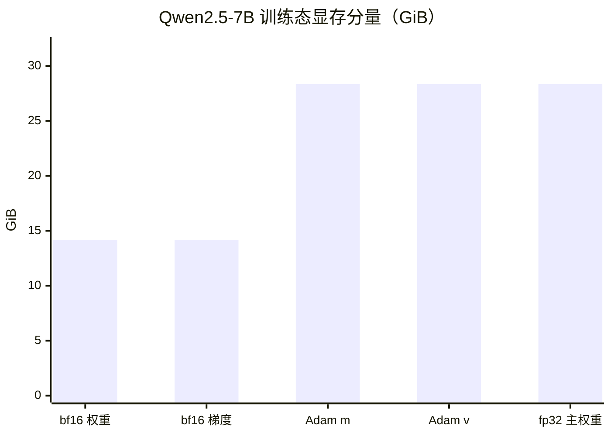

## 图 2 · 7B 的显存账本分解

对应正文 §2.1、§2.2。柱状图按 `train_plan.py` 的输出（Qwen2.5-7B，7.61B 参数，
bf16 混合精度 + fp32 Adam）绘制，单位 GiB。

合计 **113.40 GiB**（不含激活值、通信缓冲、CUDA context 与碎片）。分片之后的
每卡账本：

| 分片数 | 每卡「权重+梯度+优化器」| 还能放多少激活值 |
| --- | --- | --- |
| 1 卡 | 113.40 GiB | 放不下（单张 80GB 卡直接 OOM） |
| 8 卡 | 14.17 GiB | 宽裕，可开大 batch |
| 16 卡 | 7.09 GiB | 更宽裕 |

**读图要点**

* 显存的大头不是权重（14 GiB），而是 Adam 的 m、v 与 fp32 主权重（合计 85 GiB，
  占 75%）。这就是为什么「显存优化」的第一手段通常是分片优化器状态，而不是压缩权重。
* 去掉 fp32 主权重可省 28 GiB（某些框架用 bf16 optimizer states 做这个取舍），
  代价是更新精度下降。
* 图里没有激活值——它随 batch token 数线性增长，且与是否做 activation
  checkpointing 强相关，必须实测（正文 §2.2）。
