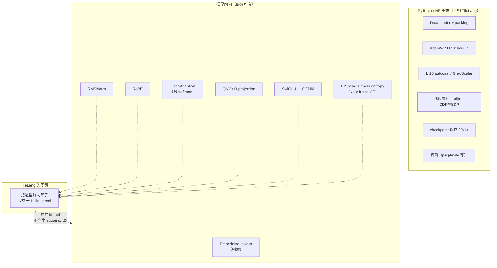

## 图 4 · 一次训练迭代里，谁归 TileLang 管

对应正文 §7。它把“模型与训练循环”（上层，属于 PyTorch/HF 生态）和“热点算子”
（下层，TileLang 的战场）分开，并标出**边界**：哪些能换、哪些别碰。

**读图要点**

* **值得换**（依收益排序的经验）：attention（含 softmax，fusion 收益最大）→
  GEMM 家族 → RMSNorm / RoPE（大批小算子的融合）→ fused cross-entropy；
  MoE 只在模型里有 MoE 时才值得。
* **别碰**：Embedding lookup（纯查表）、optimizer（逐元素 + 状态多，
  收益低风险高）、通信原语（DDP/FSDP 的 all-gather/reduce-scatter）。
* **边界条件**：TileLang 产出的是**前向 device 函数**，不会自动建 autograd 图；
  虚线箭头提醒你，换完算子必须自己补反向（`torch.autograd.Function` 或另写 kernel）。
