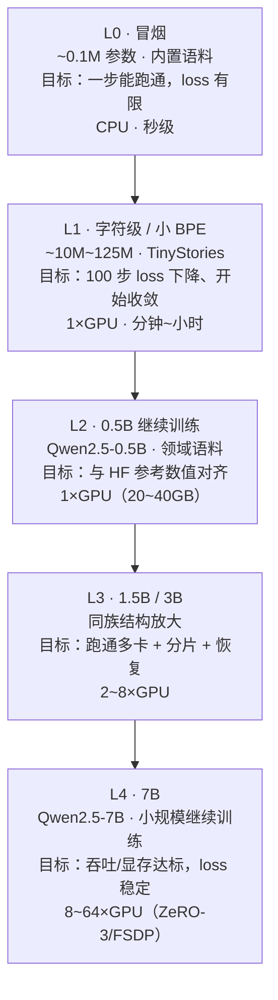

## 图 5 · 按比例缩小的降级路径

对应正文 §10。7B 全量训练单机做不了，所以本教材不要求你一步到位，而是给一个
**可以逐级验证**的阶梯：每一级都小到能在一台机器上跑完，且每一级都复用上一级的
代码与验收标准。

**读图要点**

* 阶梯的**升阶条件**：每级都要先满足“数值与 HF 参考对齐”再往上走，
  否则你会发现放大后无法定位是数据、模型还是 kernel 的问题。
* 每级的 `显存 / 时间` 都用 §2 的账本方法估：把该级的参数量代入
  `train_plan.py`（`--tokens` 与 `--eff-tflops` 用该级的真实值）。
* L2 起就必须处理分片（FSDP/ZeRO）与 `torchrun`；L0/L1 不需要。
* 昇腾把 L2~L4 的算子路径换成 `target="ascend"`（§8），但阶梯本身不变。
