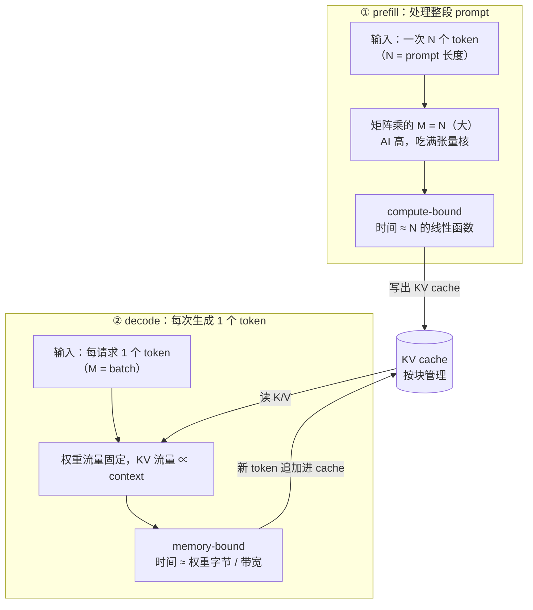

# 图 01 · 一次请求的两个阶段：prefill 与 decode



```text
ASCII 版

  prefill                              decode
  ───────                              ──────
  Q [N, d]                             Q [B, d]        ← 只有 1 个 token
  K [N, d]  →  S = QKᵀ [N, N]          K [L, d]
  V [N, d]                             V [L, d]
  O [N, d]                             O [B, d]

  M = N（几百到几十万）                M = B（1 到几百）
  AI ≫ 平衡点 → compute-bound          AI ≪ 平衡点 → memory-bound
  优化目标：把张量核喂饱、把中间结果    优化目标：少读一个字节、把 batch
  留在片上（第 15 章）                  做大、把 KV 读得更有复用（第 16 章）
```

**为什么这件事决定 kernel 选择。** prefill 的 M 很大，`T.gemm` 的 tile 划分、
流水、swizzle 都能带来收益，与第 14 章讲 GEMM 时完全一样；decode 的 M 只有
`batch`，权重流量成为主项，于是（a）要尽量把 batch 做大、（b）KV 方向必须能
切分并行（flash decoding）、（c）量化权重（读 1 字节而不是 2 字节）收益直接。

**数字从哪来。** 图中的结构性结论来自 `code/01-prefill-decode-roofline/`：
bf16 下 `AI ≈ 2M/b ≈ M`，平衡点 333 FLOP/Byte 时 M\* 约 375；
Qwen2.5-7B 的权重 15.23 GB 在 3 TB/s 上读一遍约 5.08 ms，
对应单请求速度上界约 197 tok/s（**均为公开规格下的下界模型，不是实测**）。
