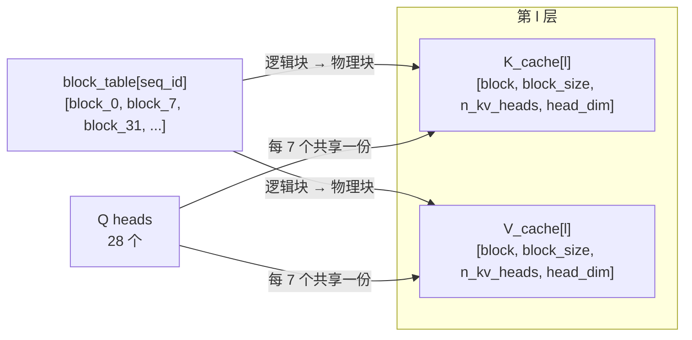

# 图 02 · KV cache 的布局、GQA 复用与 paged 块



```text
Qwen2.5-7B 的账本（bf16，模型卡 28 层 / 28 Q heads / 4 KV heads）

  每 token 每层：  2 × 4 × 128 × 2 B = 2048 B = 2 KiB
  每 token 全模型： 2 KiB × 28 = 56 KiB

  context      GQA(4 KV heads)   MHA(28 KV heads)
    8,192         448 MiB            3.06 GiB
  131,072        7.00 GiB           49.00 GiB

  decode 的算术强度：AI = 2·H_q / (H_kv · b)
    MHA 28/28 →  1.0 FLOP/B
    GQA 28/4  →  7.0 FLOP/B      ← Qwen2.5-7B
    MQA 28/1  → 28.0 FLOP/B
    平衡点       → 333 FLOP/B

  块账（block_size = 16）：每层每块 32 KiB，全模型每块 896 KiB
  一条序列的最后一块最多浪费 15 个 token 槽位

  连续分配 v.s. 分页
    ── 连续：按「最大可能长度」预留 → 变长输出下浪费巨大
    ── 分页：按需给块 → 浪费上界 = 块内碎片 + block_table 元数据
```

**为什么分页。** KV 的长度事先不知道（输出长度未知、并发数变动），连续分配
只能按上界预留；分页把“逻辑位置”和“物理位置”解耦，用一张 `block_table`
把逻辑块映射到任意物理块。代价是 attention kernel 里 KV 的地址从
`k * block_N` 变成“查表 + 偏移”，第 15 章 4.6 的 paged KV 与本章第 5 节
说的“间接寻址会破坏 TMA 静态描述符”是同一件事。

**数字从哪来。** `code/02-kv-ledger/kv_ledger.py`，可在任意机器上复算。
`hidden_size=3584 / head_dim=128 / intermediate_size=18944` 三个字段模型卡没有
直接给出，是用模型卡的两个参数量（6.53B / 7.61B）反推并互校得到的，误差 0.07%。
