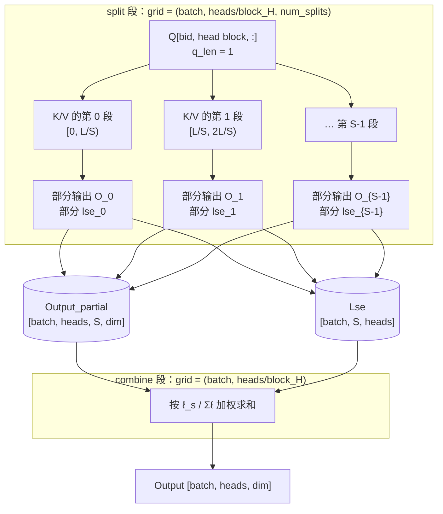

# 图 04 · flash decoding 的 split + combine 两段结构



```text
为什么必须加权，而不是简单相加

  第 s 段已经各自除掉过自己的 ℓ_s：
      O_s = (1/ℓ_s) · Σ_{j∈段 s} exp(s·x_j − m_s) · v_j

  真实输出是
      O = Σ_j P_j v_j = ( Σ_s ℓ_s · O_s ) / ( Σ_s ℓ_s )

  所以权重必须是 ℓ_s / Σ_{s'} ℓ_{s'}，而 ℓ_s = exp(lse_s)。
  代码里用 exp2/log2 配对着实现这个比值，并在求权重前先减一次最大值
  —— 与 online softmax 是同一个数值技巧。

  ⚠ 低精度下这个归约会真的伤正确性：第 15 章引用过昇腾 backward 的
    实测（厂商自报）——dQ 用 bf16 跨 64 个 KV tile 原子累加，
    相对 L2 误差约 1.024%，且不保证 bitwise 确定性。
```

**并行度从哪来。** decode 时 `batch × heads` 个块往往喂不饱机器（Qwen2.5-7B
的 `heads = 28`，batch = 1 时只有 28 个块）。split 段把 KV 方向切成 `S` 份，
并行度变成 `batch × heads × S`；代价是多一次 launch 与一份
`Output_partial`（`batch × heads × S × dim` 个元素）的显存。

**权衡。** `S` 太小时并行度不够，`S` 太大时 combine 段本身的流量与
kernel 启动开销开始占主导；`num_splits` 在官方示例里是 autotune 的一个维度
（`examples/flash_decoding/example_gqa_decode.py:18` 的 `[1, 2, 4, 8]`）。
