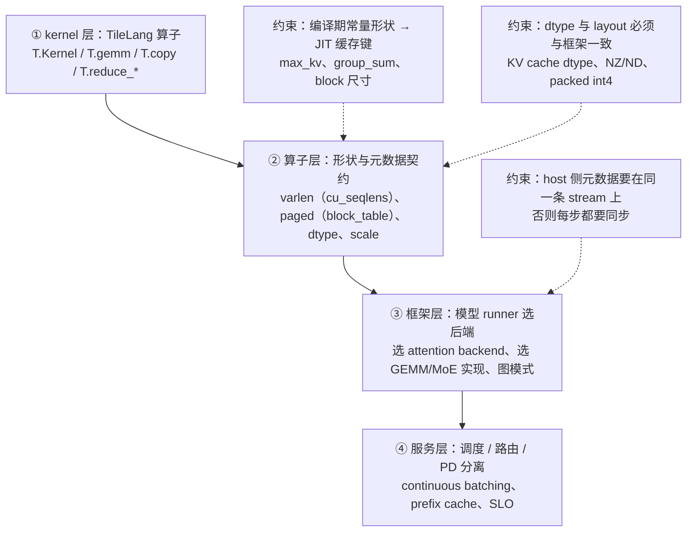

# 图 05 · 一个 TileLang kernel 进入服务框架要过的四层



```text
四个真实例子（都能在 corpus 里查到，见 references.md）

  vLLM          attention backend / GEMM backend 可替换；KV 由 PagedAttention 管；
                continuous batching + chunked prefill + prefix caching；
                文档承诺的是「可替换的 kernel 集合」，不是「怎么注册一个 kernel」。

  TileRT        预编译 wheel，一个进程只加载一个 backend 库
                （libtilert_dsv32.so / libtilert_glm5.so / libtilert_glm52_rocm.so）；
                以 vLLM prefill + TileRT decode 做 PD 分离，走 V1 的 KVConnector，
                两端 KV dtype 必须一致（fp8_ds_mla ↔ fp8）。

  vllm-ascend   vLLM 的硬件插件（hardware plugin RFC）：把「算子实现 + 图模式 +
                KV 管理」整体换到昇腾；文档给的是一条插件路线，不是逐 kernel 替换。

  ACLGraph     昇腾的图模式（NPU 侧的 CUDA Graph）：capture 一次、replay 多次，
                把 host 侧下发开销摊掉；要求形状静态 ——
                vLLM-Ascend 的图路径只覆盖 decode，prefill 仍走 eager。
```

**一句话。** kernel 写得再好，也只有在“形状/元数据契约”“dtype 与 layout”
“stream 与图模式”三件事都对上之后才会跑出效果；这三件事都不在 kernel 里，
而在本章第 6–7 节的框架与部署约束里。
