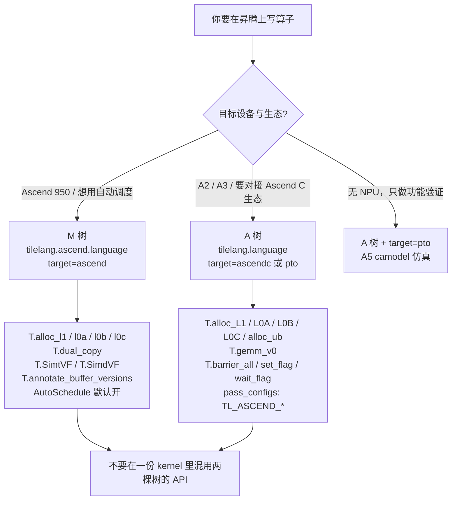

# 图 4：两棵树的选择

**用途**：正文 §7.1、§7.6。



## API 名称差异（最容易踩的坑）

```text
                     A 树（适配器）                M 树（主干）
  前端导入           tilelang.language             tilelang.ascend.language
  JIT target         "ascendc" / "pto"             "ascend"
  UB 分配            T.alloc_ub                    T.alloc_shared
  L1                 T.alloc_L1                    T.alloc_l1
  L0A / L0B / L0C    T.alloc_L0A/L0B/L0C           T.alloc_l0a/l0b/l0c
  子核               (cid, vid)                    T.MixedKernel(N, sids=2) -> (bx, sid)
  矩阵乘             T.gemm_v0                     T.gemm(..., unit_flag_ctrl=...)
  双 AIV 拷贝        手写 vid 切分                 T.dual_copy
  设备打印           T.printf / T.dump_tensor      T.print（无 dump_tensor）
  配置开关           TL_ASCEND_*（PassConfigKey）   TL_ENABLE_AUTO_SCHEDULE
  do_bench 后端      "msprof"                      "msprof" / "msprof_detail"
```

来源：两棵树的源码逐条比对（见 `../references.md` 的 A1–A8、S1–S12）。
