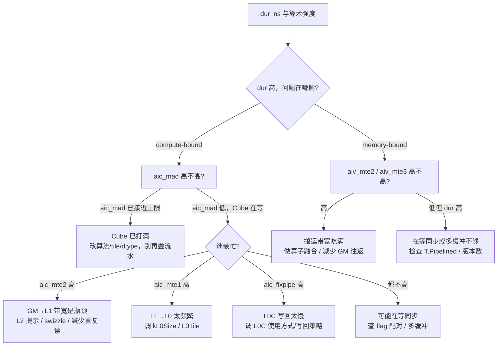

# 图 5：瓶颈判读决策树

**用途**：正文 §8.3。输入是 M 树 `do_bench(backend="msprof_detail")` 返回的
`KernelProfile`（`tilelang/profiler/msprof.py:60-134`）。

## 三条核心判据

1. **Cube 忙不忙**：`aic_mad` 高 + `dur` 高 → 计算瓶颈，改算法；`aic_mad` 低 →
   Cube 在等数据，看 `aic_mte1/2` 与 `aic_fixpipe`。
2. **Cube 在等谁**：`aic_mte2` → GM→L1；`aic_mte1` → L1→L0；`aic_fixpipe` → L0C 写回。
3. **Vector 侧**：`aiv_mte2/3` 高而 `aiv_vec` 低 → 纯搬运受限，做融合。

## 读这些比值时的两个陷阱

* **AIC 与 AIV 的比值各自相对自己的 `total_cycles`**，不要相加当成一个统一时间轴的占比。
* `do_bench(backend="msprof")` 不带 median/quantile 选择，多取几次自己求中位数。

来源：M 树 `tilelang/profiler/msprof.py:60-134`（字段定义）、
`references/profiling.md`（口径与用法）、`SKILL.md` §12（实验方法）。
本图是**判读方法**，不含任何实测数字。
