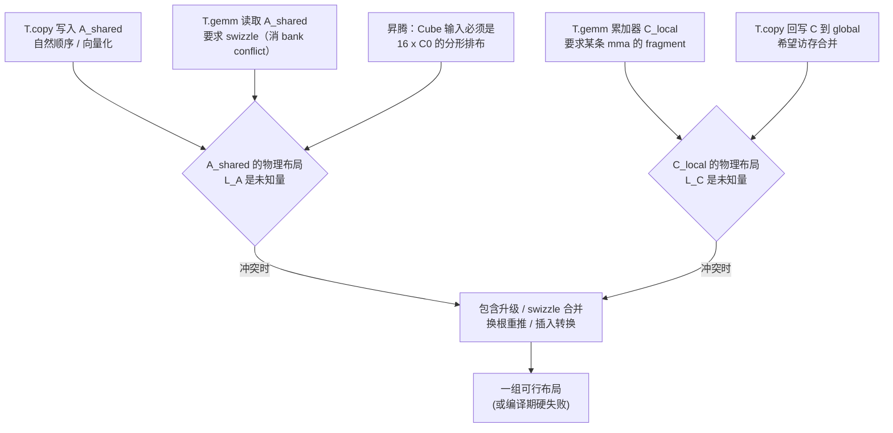

# 图 1：三类约束汇聚到一个 buffer 的物理布局

来源：`_vendor/tilelang-v0.1.15/tilelang/cuda/op/gemm/gemm_mma.py:42-66`
（mma fragment / swizzle 约束）；`src/layout/gemm_layouts.cc:442-530`（swizzle 档位）；
`src/ascend/layout/ascend_layouts.h:20-27`（分形对齐）。图的结论是**本书推导**。

## Mermaid



## ASCII

```text
  tile op 1 (T.copy)            tile op 2 (T.gemm)          tile op 3 (T.Parallel)
        │                             │                            │
        │ 约束：搬运顺序              │ 约束：swizzle / fragment   │ 约束：循环可寻址
        ▼                             ▼                            ▼
   ┌──────────────────────────────────────────────────────────────────────┐
   │                  求解：给每个 buffer 选一个 layout                    │
   │      冲突时：包含检查 → swizzle 合并 → 换根重推 → 否则硬失败           │
   └──────────────────────────────────────────────────────────────────────┘
```
