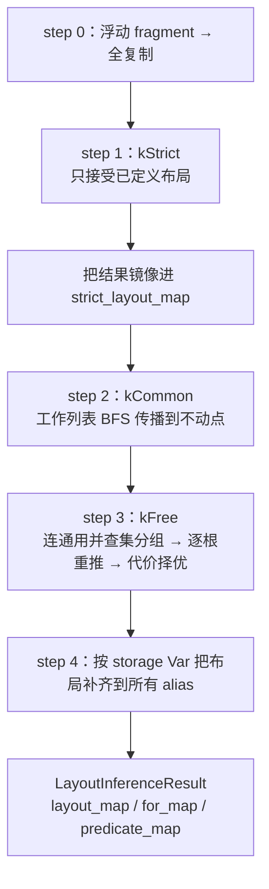

# 图 3：推断引擎的 step 0–4 与三级约束

来源：`_vendor/tilelang-v0.1.15/src/transform/layout_inference/layout_inference.cc:538-690`
（`Run`）、`:1396-1550`（`InferInFreeMode`）；三级语义见
`src/op/parallel.cc:311-329`。图为**本书绘制**。

## Mermaid



## ASCII（工作列表的优先级入队）

```text
  q: [op0, op1, op2, ...]
  某个 op 产出新布局 → 写 layout_map
        │
        ├─ 若下游 op 已接触的 buffer 里已有布局 → push_front（先处理）
        └─ 否则                                 → push_back （后处理）
  循环直到 q 空（不动点）
```

关键实现点：`EnqueueWithPriority`（`layout_inference.cc:762-777`）；
结果以 **annotation** 形式挂回 IR（`:1581-1586` Block / `:1605-1633` For），
真正改写发生在后面的 `LowerTileOp`。
