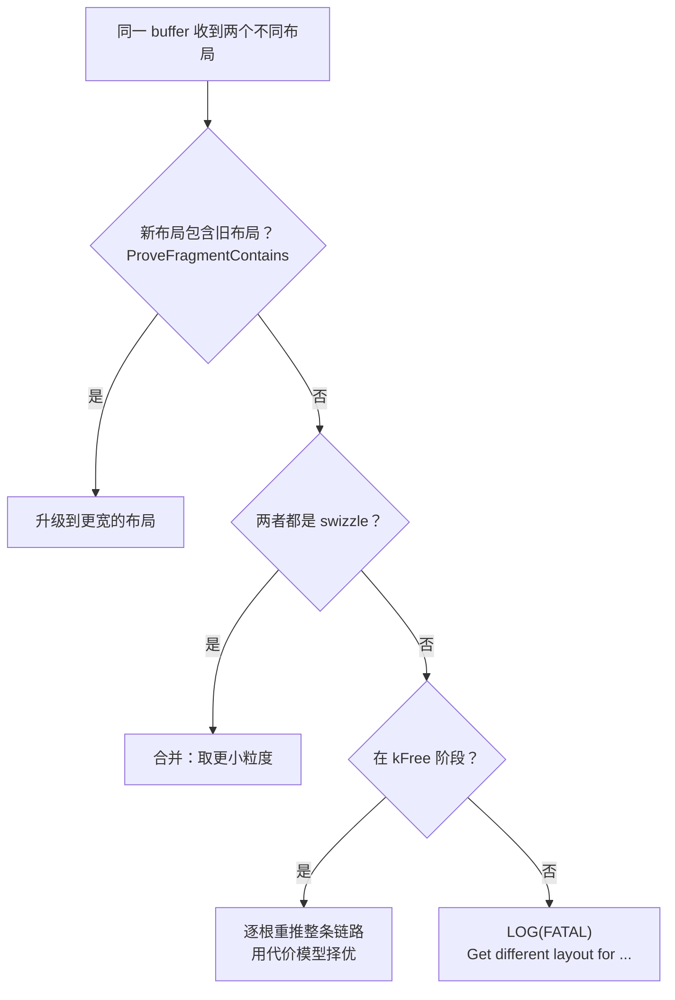

# 图 4：冲突的三条出路与代价择优

来源：`_vendor/tilelang-v0.1.15/src/transform/layout_inference/layout_inference.cc:437-468`
（三条出路）、`src/layout/utils.cc:443-480`（包含检查）、
`src/layout/gemm_layouts.cc:999-1023`（swizzle 合并）、
`src/transform/layout_inference/layout_cost_model.h:1-90`（代价）。图为**本书绘制**。

## Mermaid



## 代价比较（字典序）

```text
   AttemptCost { mem, regs }
   BetterThan(other):
       mem  != other.mem  ->  mem  < other.mem
       mem  == other.mem  ->  regs < other.regs

   register-count（默认）: mem = 寄存器数组溢出字节;  regs = fragment 槽位总数
   io-aware    （可选）  : mem 再叠加 触及 global 的语句按
                           max(带宽字节, 发射等价字节)
```

配置键：`tl.layout_cost_model`（`tilelang/transform/pass_config.py:122`）。
切换模型会改变同一次编译的推导结果——可作为「转换代价被忽略」的实验。
