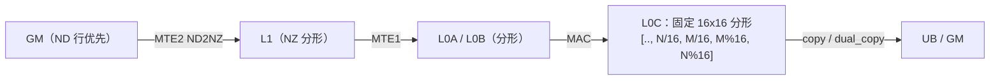

# 图 5：Cube 的 NZ 分形与昇腾四个 pass

来源：`_vendor/tilelang-v0.1.15/src/ascend/layout/ascend_layouts.cc:111-115`、
`src/ascend/layout/ascend_layouts.h:20-27`（分形公式与 C0）；
`tilelang/ascend/pipeline.py:83-101`（pass 顺序）。图为**本书绘制**。

## NZ 物理形状

```text
逻辑 [ .. , rows, cols ]
        │
        ▼   C0 = 32 bytes / element_size = 256 / element_bits
物理 [ .. , cols/C0 , rows/16 , 16 , C0 ]

  C0:  fp16/bf16 = 16      fp32 = 8      int8 = 32      int4 = 64

  例（bf16）：逻辑 [64, 48]  ->  物理 [3, 4, 16, 16]
  例（fp32）：逻辑 [64, 48]  ->  物理 [6, 4, 16, 8]
```



## 昇腾 pass 顺序

```text
 AscendLayoutInference         ← 推断（VF 区域不透明）
      │
 NormalizeAscendFractalStorage ← 统一 alias、吸收 reshape、加 padding（不置零）
      │
 InsertNd2Nz                   ← UB→L1 copy 改写成 scatter + post_copy
      │
 VFChecker
      │
 AscendInsertOOBPadding        ← clamp 越界尾部 + 补 tl.fill（让调度器看见依赖）
      │
 AutoSchedule（可选）→ … → InsertSync → MaterializeMultiBuffer
```

**与 NV 的差异**：NV 的张量核布局是**寄存器 fragment** 层面的约束（shared 只要能
喂饱 `ldmatrix` 即可）；昇腾的 Cube 布局是**片上存储**层面的约束，数据必须真的以
分形格式落盘，因此多了 `NormalizeAscendFractalStorage` 与 `InsertNd2Nz` 两个
NV 侧不存在的 pass。
