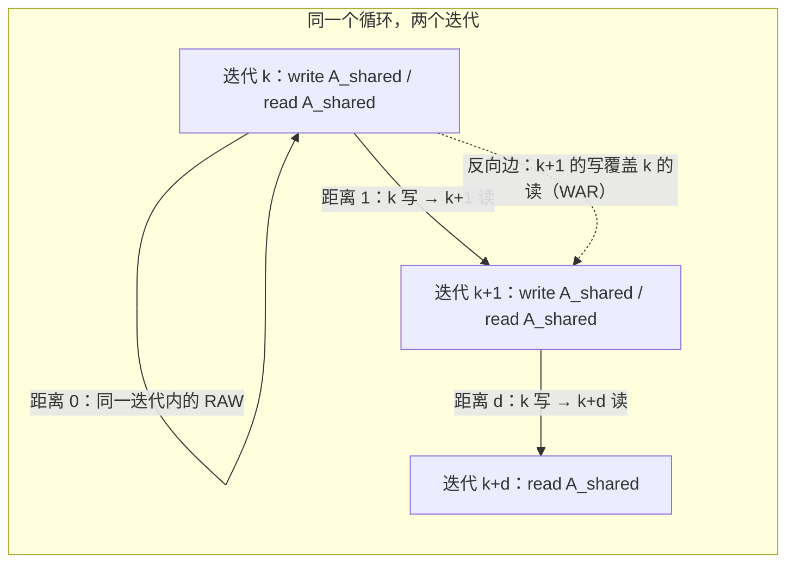

# 图 1：依赖、依赖距离与循环携带依赖

对应正文 §2.1。要点：把「第 k 轮写、第 k+d 轮读」写成一条带**距离**的边，
流水与多缓冲才有可计算的对象；`d = 0` 是同迭代依赖，`d ≥ 1` 是循环携带依赖
（loop-carried dependence）。

## Mermaid 版本



## ASCII 版本

```text
          迭代 k                 迭代 k+1              迭代 k+2
   ┌──────────────────┐   ┌──────────────────┐   ┌──────────────────┐
   │ copy → A_shared  │   │ copy → A_shared  │   │ copy → A_shared  │
   │ gemm ← A_shared  │   │ gemm ← A_shared  │   │ gemm ← A_shared  │
   └──────────────────┘   └──────────────────┘   └──────────────────┘
          │  │                    │  │                    │
          │  └── 距离 0 ───────────┘  │                    │
          │     （同一迭代内的 RAW）  │                    │
          │                         │                    │
          └──── 距离 1（循环携带） ──┘                    │
                「k+1 轮的 copy 覆盖 k 轮正在读的槽」      │
                                             距离 d ──────┘

   距离 1 的那条边就是决定「buffer 至少要几个版本」的边。
```

## 定义表

| 概念 | 本文写法 | 在 TileLang 里的落点 |
| --- | --- | --- |
| 访问集 | `R(s)` / `W(s)`：语句 `s` 读/写哪些 buffer region | `SBlock::reads` / `SBlock::writes`，由 `GetSBlockReadWriteRegion` 推出 |
| 依赖边 | `p → c`，`p` 先于 `c` | `BuildDependencyGraph`（`ValidatePipelineBody` 用它） |
| 依赖距离 | `d`：`c` 的第 `k + d` 次迭代依赖 `p` 的第 `k` 次 | `DepInfo::distance`：`0` 同迭代、`-1` 未解析的跨迭代、`≥1` 显式距离 |
| 三种 hazard | RAW（写→读）、WAR（读→写）、WAW（写→写） | CUDA 侧在 `FindConflict` 里按访问冲突统一判定；昇腾侧由 `AnalyzeDependencies` 给有向边，再由 `InsertSync` 落成 flag |

## 为什么「距离」是这一章的枢纽

1. 距离 0 的边**在同一迭代内**就能被顺序满足；距离 `d ≥ 1` 的边必须由
   「多个 buffer 版本」或「等待」来满足。
2. 环形多缓冲给出的保证是：第 `k` 轮写的槽，会在第 `k + depth` 轮被重写。
   把 `depth` 调到 `≥ d`，跨迭代的那条边就从「必须等待」变成「换个槽写」。
3. 同步器要处理的正是**换不掉的**边，以及**换了槽之后仍然相交**的那些边：
   `MayConflict` 用区间相交判断「两个 region 是否可能撞上」，这是
   「同一条边要不要同步」的第一道闸门。

## 来源

* `_vendor/tilelang-v0.1.15/src/transform/inject_pipeline.cc:1421-1472`（读写集、`def`/`use` stage、`MayConflict`）
* `_vendor/tilelang-v0.1.15/src/ascend/transform/auto_schedule/dependency_analysis.h:44-75`（`DependencyKind`、`DepInfo::distance`）
* `../tilelang-corpus/02-tilelang-core-repo/raw/tilelang/.agents/skills/tilelang-ascend/references/synchronization.md`（「Keep task stages, dependency distance, and storage slot count distinct.」）
