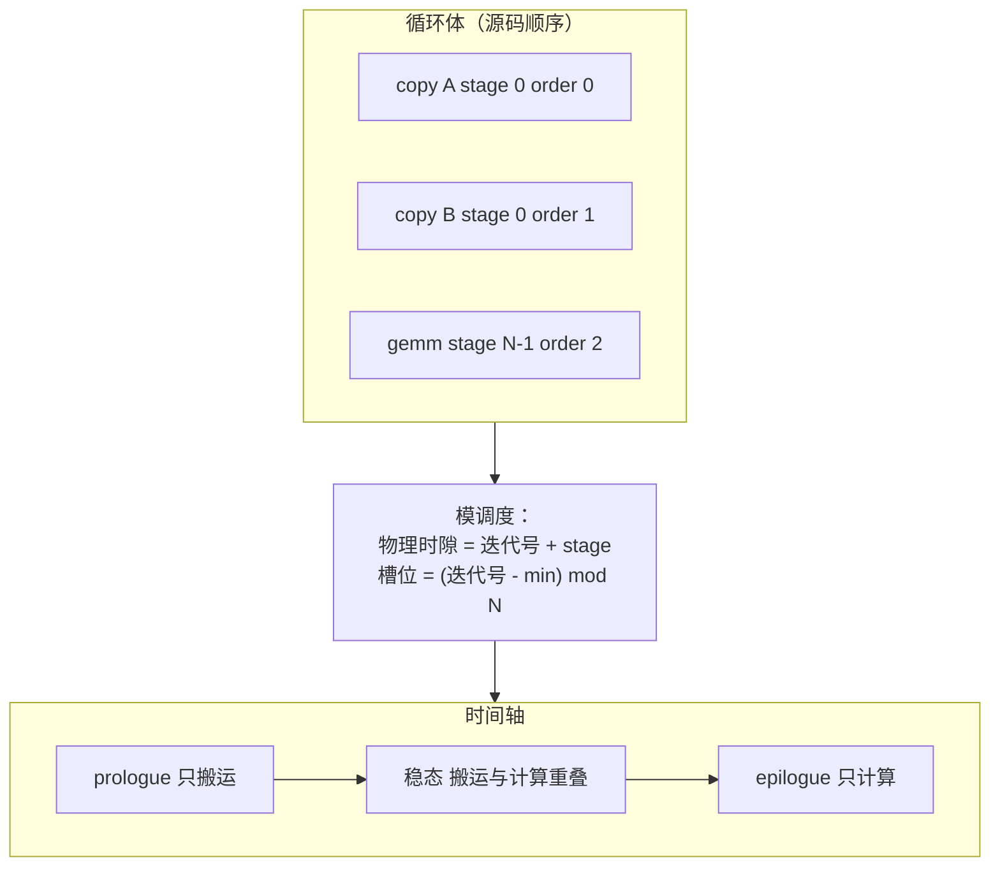

# 图 2：从 stage/order 到模调度（modulo scheduling）

对应正文 §2.2–§2.3。要点：`(stage, order)` 是用户/规划器给出的**逻辑**位置，
模调度把“迭代 `k` 的 stage `s`”映射到“第 `k + s` 个物理时隙里的第 `order` 位”；
prologue 与 epilogue 就是这条映射在边界上的余数。

## Mermaid 版本



## ASCII 版本（num_stages = 3，循环体 = copy A / copy B / gemm）

```text
stage/order 注解（PipelinePlanning 写进循环注解的形态）：
    stage = [0, 0, 2]      order = [0, 1, 2]
            copyA copyB gemm

模调度：物理时隙 t 上执行「逻辑迭代 t − stage」里 order 最小的未完成语句

  t=0   t=1   t=2   t=3   t=4   t=5   t=6   t=7   t=8
 ┌───┬─────┬─────┬─────┬─────┬─────┬─────┬─────┬─────┐
 │A0 │A1 B0│A2 B1│A3 B2│ B3  │     │     │     │     │  copy（stage 0）
 │   │     │ g0  │ g1  │ g2  │ g3  │ g4  │ g5  │     │  gemm（stage 2）
 └───┴─────┴─────┴─────┴─────┴─────┴─────┴─────┴─────┘
  └── prologue ──┘└────────── 稳态 ──────────┘└ epilogue ┘

槽位轮转（版本数 = use − def + 1 = (N−1) − 0 + 1 = 3）：

  写 A2 用槽 2    读 A0 用槽 0    写 A3 用槽 0 ← 覆盖 A0 的槽
                                     ↑
                      只有当 gemm0 已经读完槽 0，这次覆盖才合法
                      → 这就是同步插入要保证的那件事

启动间隔（initiation interval, II）：稳态里相邻两次「同一 stage 语句」的间距。
本例里 II = 1 个物理时隙；真实机器上 II = max(计算时间, 搬运时间, 依赖约束)。
```

## 三句话

1. **`stage` 是逻辑位置**，决定“谁和谁重叠”；**`order` 是同 stage 内的发射顺序**，
   决定“谁先谁后”。两者共同决定 `InjectSoftwarePipeline` 生成的
   prologue / body / epilogue 三段。
2. **深度不是 stage 本身**：`depth = max(stage) + 1`，但也可以由 `num_stages`
   直接给出（`GetPipelineNumStages` 的三级读取）。
3. **版本数来自 stage 的跨度**，不是来自深度：`use − def + 1` 只看同一 buffer
   最早被写、最晚被读的那两个 stage。

## 来源

* `_vendor/tilelang-v0.1.15/src/transform/pipeline_planning.cc:1226-1305`（自动 stage/order 的分配与收尾整形）
* `_vendor/tilelang-v0.1.15/src/transform/common/pipeline_utils.h:74-110`（`GetPipelineNumStages` 的三级读取）
* 上游单测（同一形态的权威读数）：`../tilelang-corpus/02-tilelang-core-repo/raw/testing/python/transform/test_tilelang_transform_pipeline_planning.py`，`test_pipeline_planning_before_after_copy_gemm_num_stages_plan`
