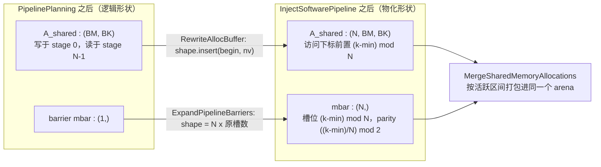

# 图 3：版本维的物化，以及 barrier 也要多版本

对应正文 §3.1–§3.3。要点：多缓冲在 IR 上的落地只有两条动作——**给 buffer 加一个
最外层版本维**，**把每个访问的下标改成 `(k − min) mod nv`**；barrier 不能例外，
它同样要按 stage 展开，并带上自己的 parity。

## Mermaid 版本



## ASCII 版本

```text
┌─ 物化前 ─────────────────────────────┐   ┌─ 物化后 ──────────────────────────────┐
│ A_shared : (128, 64) fp16 = 16 KiB   │   │ A_shared : (3, 128, 64) fp16 = 48 KiB │
│ 每轮都被写、也被读                    │   │ 槽位 = (ko − min) mod 3               │
└──────────────────────────────────────┘   └───────────────────────────────────────┘
                                                       │
                    ┌──────────────────────────────────┴────────────────────────┐
                    │ 版本数 = use_stage − def_stage + 1 = (N−1) − 0 + 1 = N       │
                    │ 形状改写：RewriteAllocBuffer（shape.insert(begin, nv)）      │
                    │ 下标改写：Store 前置 version；Load 同样前置 version          │
                    │           tvm_access_ptr 走 version × 总长 的字节偏移        │
                    └───────────────────────────────────────────────────────────┘

同一趟里还有两件常被忘记的事：

  (1) 访问区域要放宽。prologue/epilogue 里只有一份版本活着，body 里所有版本都
      可能被碰到，所以块的 read/write region 首维要改成 [0, nv)
      （access_all_versions）——否则依赖分析会以为两个 stage 撞在同一份数据上。

  (2) barrier 也要多版本。cp.async 的 arrive/wait 与 TMA 的 mbarrier 都按
      stage 排队：ExpandPipelineBarriers 把 [N_bar] 改成 [nv × N_bar]，
      并把 wait 的 parity 改成 ((k − min) / nv) mod 2。
      少了这一步，第 k 轮的 wait 会等到第 k+1 轮才到的那次 arrive。
```

## 与「复用」的关系

版本维一加，`A_shared` 的字节数就乘了 `nv`，它是一个**整体**参与 arena 打包的：
`MergeSharedMemoryAllocations` 不会把不同版本拆开复用，只会让**不同的 buffer**
在活跃区间不重叠时共用同一段偏移。这就是「多缓冲挤掉的复用机会」的来源。

## 来源

* `_vendor/tilelang-v0.1.15/src/transform/inject_pipeline.cc:1488-1542`（版本数）
* `_vendor/tilelang-v0.1.15/src/transform/inject_pipeline.cc:1551-1560`（`RewriteAllocBuffer`）
* `_vendor/tilelang-v0.1.15/src/transform/inject_pipeline.cc:1038-1056`、`:1115-1145`（版本下标与区域放宽）
* `_vendor/tilelang-v0.1.15/src/transform/inject_pipeline.cc:785-886`（`ExpandPipelineBarriers`：`[N × num_stages]` 与 parity）
* `_vendor/tilelang-v0.1.15/src/transform/merge_shared_memory_allocations.cc:1576-1668`（arena 打包入口）
