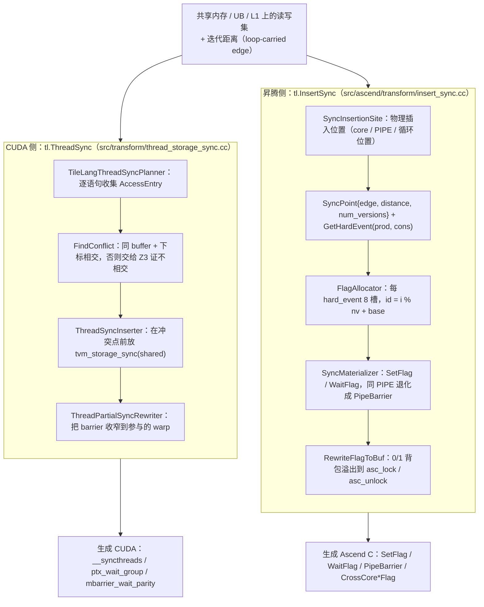

# 图 4：从读写集到同步点——CUDA 与昇腾的两条路径

对应正文 §4。要点：两条路径的**输入是同一个东西**（带距离的访问冲突），
但**输出不是同一个东西**：CUDA 侧落成 `__syncthreads()` / `cp.async.wait_group` /
mbarrier parity，昇腾侧落成 `SetFlag/WaitFlag`（或 `PipeBarrier`），并且必须经过
「flag 槽位分配」这一层资源约束。

## Mermaid 版本



## ASCII 版本

```text
                    共享内存上的读写集 + 迭代距离
                                │
        ┌───────────────────────┴────────────────────────┐
        │                                                │
   CUDA 侧                                         昇腾侧
   thread_storage_sync.cc                          ascend/transform/insert_sync.cc
   ─────────────────────                          ──────────────────────────────
   逐语句收集 access 条目                          为每个任务算「物理插入位置」
        │  {buffer, 下标, 线程约束, 是否 atomic}          │  site = (core, PIPE, 循环位置)
        ▼                                                ▼
   FindConflict(prev, curr, loop)                  CollectSyncPoints()
     · 不同 buffer → 无关                            · edge = (prod, cons)
     · 都是 atomic → 无关                            · distance → num_versions
     · 下标恒等 + 参与者相同 → 无关                   · kind = kData / kOwnerExclusion
     · 否则 Z3 证「字节区间不相交」                   ▼
        │  （证不出来就保守认定冲突）              SyncPoint 列表
        ▼                                                │
   在冲突两侧插 tvm_storage_sync("shared")          FlagAllocator.Plan()
        │                                                │  required_ids[hard_event] += nv
        ▼                                                │  超 8 槽 → 可复用配对合并 base
   ThreadPartialSyncRewriter                             ▼
   （把全块 barrier 收窄到参与的 warp 集合）        SyncMaterializer
        │                                           同 PIPE 且非 S/V/M → PipeBarrier
        │                                           否则 SetFlag / WaitFlag(event_id)
        ▼                                                │
   __syncthreads() / ptx_wait_group /               ▼
   mbarrier_wait_parity(bar, parity)             RewriteFlagToBuf
                                                 （0/1 背包容量 8 → 溢出到
                                                  asc_lock / asc_unlock 互斥池）
```

## 三个必须记住的差异

| 维度 | CUDA 侧 | 昇腾侧 |
| --- | --- | --- |
| 同步原语 | 块级 barrier（`__syncthreads`）、异步拷贝的 `wait_group`、mbarrier 的 arrive/parity wait | `SetFlag/WaitFlag`（带 `HardEvent` 与 event id）、`PipeBarrier`、`CrossCoreSetFlag/WaitFlag` |
| 「谁等谁」怎么表达 | 用 barrier 的**位置**表达；barrier 本身不区分生产者与消费者 | 用 `HardEvent = PROD_CONS` 的**有向**事件对表达，天然区分方向 |
| 资源约束 | 主要是 barrier 数量与异步组数（`cp.async` 在飞组数） | 每个 `HardEvent` **只有 8 个 event id**，超出要背包挑选并溢出到互斥池 |
| 与多缓冲的关系 | 版本维由 `InjectSoftwarePipeline` 加，barrier 由 `ExpandPipelineBarriers` 同步展开 | 版本由 `PrepareMultiBuffer` / `MaterializeMultiBuffer` 管，`InsertSync` 直接消费 `num_versions` 生成 `event_id = i % nv + base` |

## 来源

* `_vendor/tilelang-v0.1.15/src/transform/thread_storage_sync.cc:603-700`（`TileLangThreadSyncPlanner` 与 `AccessEntry`）、`:1759-2043`（`FindConflict` 与 Z3 证明）、`:2058-2100`（pass 驱动与三段调用）
* `_vendor/tilelang-v0.1.15/src/ascend/transform/insert_sync.cc:82-260`（site / edge / sync point 数据模型）、`:1226-1400`（`CollectSyncPoints`）、`:2299-2307`（`MakeFlagEventId`）、`:2344-2480`（`SyncMaterializer`）
* `_vendor/tilelang-v0.1.15/src/ascend/transform/rewrite_flag_to_buf.cc:1-31`（flag 命名空间与背包溢出的设计说明）
* `_vendor/tilelang-v0.1.15/src/ascend/transform/thread_storage_sync.cc:2054-2124`（`AscendThreadSync`：昇腾上只处理 `SimtVF` 块）
