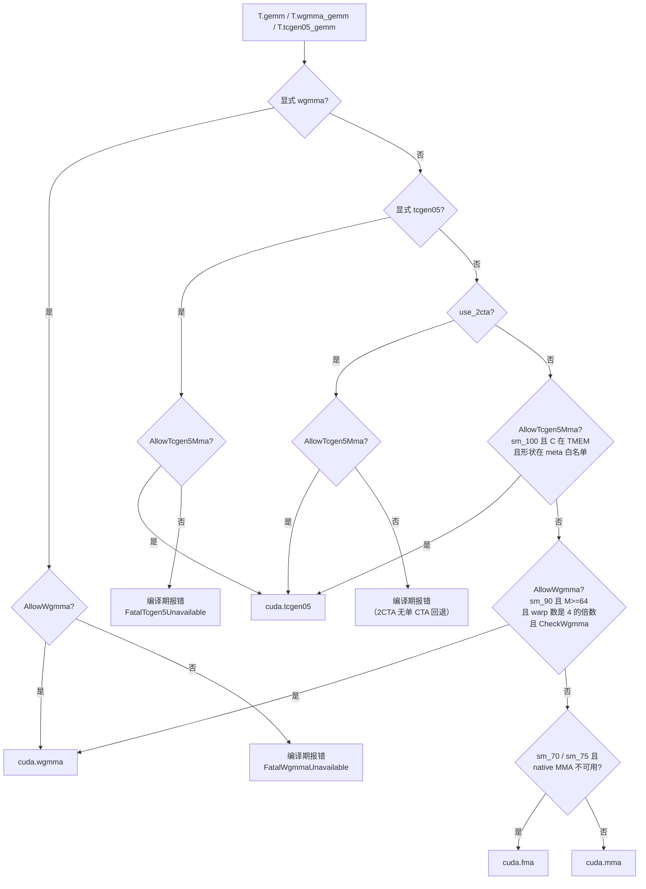

# 图 2：`T.gemm` 的指令选择判定树

对应 `_vendor/tilelang-v0.1.15/src/cuda/op/gemm.cc:336-375` 的 `Gemm::SelectInst`。

`AllowTcgen5Mma` 的三条硬条件（`src/cuda/op/gemm.cc:80-87`）：

1. `TargetIsSm100(target)`；
2. `A` 在 shared 或 TMEM、`B` 在 shared、**`C` 在 TMEM**；
3. `GetTCGEN5MMAMeta(M, N, K, ab_dtype, c_dtype).first` 为真。

`AllowWgmma` 的三条硬条件（`src/cuda/op/gemm.cc:89-97`）：Hopper、`M >= 64`、
`num_warps % 4 == 0`，外加 `CheckWgmma` 的 dtype/转置/K 整除约束。
