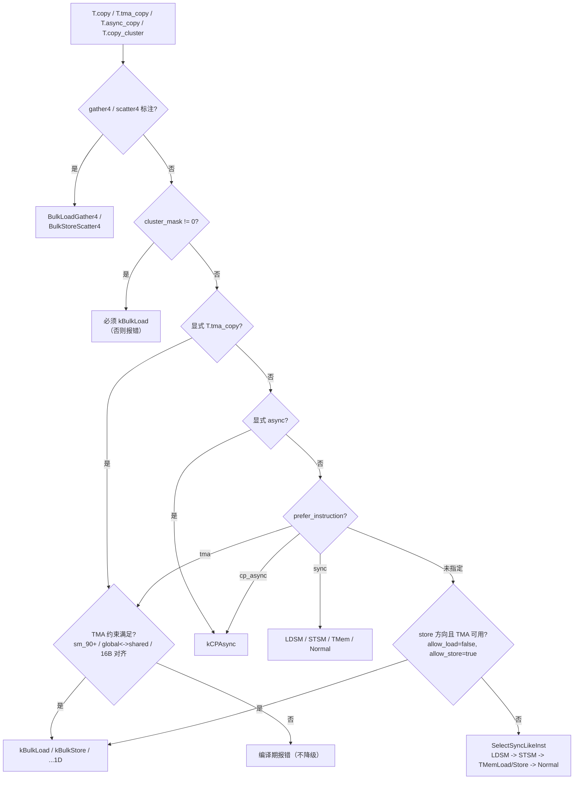

# 图 3：`T.copy` 的搬运指令选择判定树

对应 `_vendor/tilelang-v0.1.15/src/cuda/op/copy_analysis.cc:716-891`。

**默认路径只对 store 自动选 TMA**（`_vendor/tilelang-v0.1.15/src/cuda/op/copy_analysis.cc:797-803`）。load 想走 TMA 需要在
`T.tma_copy`、`prefer_instruction="tma"`、或 warp-specialized producer 分支三者之一里。

TMA 的硬条件（`CheckBulkLoad` / `CheckBulkStore` / `CheckGlobalStrides`，
`_vendor/tilelang-v0.1.15/src/cuda/op/copy_analysis.cc:143-261`）：

* `arch >= 90`（`src/cuda/target_utils.cc:117-122`）；
* 作用域必须是 `global` ↔ `shared`/`shared.dyn`；
* 最后一维位数是 128 的整数倍；
* 最内层 stride 为 1，其余 stride 的字节数能被 16 整除且 < 2^40；
* dtype 对（含 FP4 只支持 load 方向的特殊规则）。
