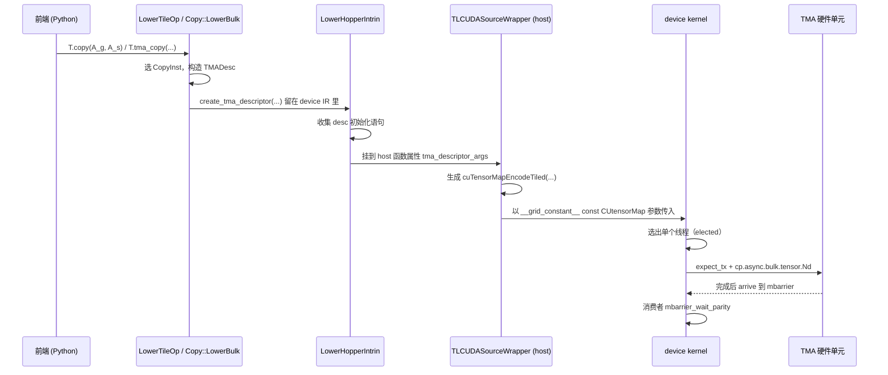

# 图 4：TMA 描述符的流转

源码位置：

* 构造描述符与发射：`_vendor/tilelang-v0.1.15/src/cuda/op/copy.cc:2108-2215`；
* 提升为 host 属性：`_vendor/tilelang-v0.1.15/src/cuda/transform/lower_hopper_intrin.cc:27-44`；
* host 侧编码模板：`_vendor/tilelang-v0.1.15/tilelang/jit/adapter/wrapper.py:111-131`（`cuTensorMapEncodeTiled`）与
  `:133-159`（`cuTensorMapEncodeIm2col`）；
* device 侧 PTX：`_vendor/tilelang-v0.1.15/src/tl_templates/cuda/copy_sm90.h:212-270`（普通）
  与 `:88-210`（multicast）；
* mbarrier 原语：`_vendor/tilelang-v0.1.15/src/tl_templates/cuda/barrier.h:11`（`mbarrier_init`）、
  `:112`（`mbarrier_arrive_expect_tx`）、`:34`（`mbarrier_wait`）、
  `:184`（`tma_store_arrive`）、`:194`（`tma_store_wait`）。
