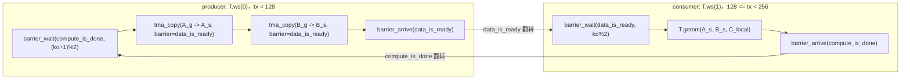

# 图 5：warp specialization 的角色与握手

以 `_vendor/tilelang-v0.1.15/examples/warp_specialize/example_warp_specialize_gemm_copy_0_gemm_1.py`
为例（256 线程 = 2 个 warp group）。



编译期顺序（仅当目标是 CUDA 且 `have_tma(target)`，也就是 `arch >= 9`）：

```text
AutoWarpSpecialization      （opt-in：tl.enable_auto_warp_specialization）
        ↓
MaterializeWSSchedule       （物化 WSSchedule：角色分支 + 多版本 buffer + mbarrier）
        ↓
ProducerConsumerWarpSpecialized （在 tile-op 层改写 pipelined loop）
        ↓
... LayoutInference / LowerTileOp ...
        ↓
AnnotateWarpGroupRegAlloc   （注入 set_max_nreg）
```

源码位置：`_vendor/tilelang-v0.1.15/tilelang/cuda/pipeline.py:101-109`、
`:27-38`（门禁）、`:268-271`（寄存器）。指令分类在
`_vendor/tilelang-v0.1.15/src/cuda/transform/ws_analysis.h:33-41`。
