# 图 1：四条昇腾编译路线

来源：`_vendor/tilelang-v0.1.15/tilelang/ascend/backend.py:52-62`、
`_vendor/tilelang-v0.1.15/tilelang/ascend/codegen.py:5-9`、
`_vendor/tilelang-ascend-v0.1.2.000/tilelang/engine/lower.py:156-170`、
`_vendor/tilelang-ascend-v0.1.2.000/tilelang/jit/adapter/libgen.py:150-230`、
`../tilelang-corpus/07-tilelang-ascend-adapter/raw/tilelang-mlir-ascend/tilelang/jit/jit_npu.py:1862-1916`。
图为**本书绘制**，「生成物」一栏的措辞来自各自 codegen 的 include / 输出名前缀。

## Mermaid

```mermaid
flowchart TD
    subgraph M["M 树：_vendor/tilelang-v0.1.15（主干）"]
        M0["@tilelang.jit(target='ascend' | 'asc')"] --> M1["AscendPassPipelineBody<br/>tilelang/ascend/pipeline.py:36"]
        M1 --> M2["CodeGenTileLangAscend<br/>src/ascend/codegen/codegen_ascend.cc"]
        M2 --> M3["CCE/Ascend C 源<br/>asc_* intrinsic + __ubuf__/__cbuf__"]
        M3 --> M4["bisheng --npu-arch=dav-3510<br/>+ ld.lld 链接"]
        M4 --> M5["可执行 CCE ELF (aibin)"]
    end

    subgraph A["A 树：_vendor/tilelang-ascend-v0.1.2.000（适配器）"]
        A0["@tilelang.jit(target='ascendc')"] --> A1["engine/phase.py 两个阶段"]
        A1 --> A2["CodeGenTileLangAscend<br/>src/target/codegen_ascend.cc"]
        A2 --> A3["AscendC 类库 C++<br/>AscendC::TPipe / TBuf / GetWithOffset"]
        A3 --> A4["bisheng --npu-arch=dav-2201 -xasc --shared"]
        A4 --> A5[".so"]

        B0["@tilelang.jit(target='pto')"] --> B1["engine/phase.py 同一套 pass"]
        B1 --> B2["CodeGenTileLangAscendPto<br/>src/target/codegen_ascend_pto.cc"]
        B2 --> B3["PTO-DSL C++<br/>pto::Tile / TLOAD / TMATMUL 模板"]
        B3 --> B4["bisheng --cce-aicore-arch=dav-c220|c310 -xcce"]
        B4 --> B5[".so"]
    end

    subgraph L["MLIR 仓库：tilelang-mlir-ascend（AscendNPU IR）"]
        L0["TVM target kind 'npuir'"] --> L1["codegen_npuir_apis / _dev"]
        L1 --> L2["AscendNPU IR（MLIR 文本）"]
        L2 --> L3["MLIR pass: canonicalize / adapt-triton-kernel"]
        L3 --> L4["bishengir-compile<br/>--enable-hivm-compile=true ..."]
        L4 --> L5["kernel.o"]
    end
```



## ASCII

```text
            前端                       中端                     codegen                 编译器
M 树   T.Kernel/T.copy/T.gemm  →  AscendPassPipelineBody  →  CodeGenTileLangAscend  →  bisheng dav-3510  →  aibin
A 树   T.Kernel(is_npu=True)   →  phase.py(2 phase)       →  CodeGenTileLangAscend  →  bisheng dav-2201  →  .so
       T.Kernel(is_npu=True)   →  phase.py(2 phase)       →  CodeGenTileLangAscendPto→ bisheng -xcce      →  .so
MLIR   TVM target 'npuir'      →  MLIR pass pipeline      →  codegen_npuir_*         →  bishengir-compile →  .o
```

要点：

* **只有 M 树进了主干**（`v0.1.15`）；A 树两条路线与 MLIR 路线分别在自己的仓库 /
  分支里，锁定版本是 `_vendor/tilelang-ascend-v0.1.2.000` 与 corpus 里的
  `tilelang-mlir-ascend` 快照。
* **PTO 在 v0.1.15 不存在**：v0.1.15 里搜不到 `ascend_pto` / `"pto"` target
  （见 `code/03-api-presence-matrix/api_matrix.py`）。把 PTO 带进主干的是 PR3310；
  corpus 的 main 源码快照（commit `994b44e`）就是它的合并提交，PR 页面快照则显示 draft。
