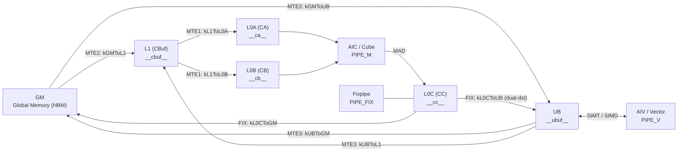

# 图 2：存储层级、DMA 通路与硬件流水线

来源：`_vendor/tilelang-v0.1.15/src/ascend/op/oob_padding.h:32-44`（`DMAPath`）、
`oob_padding.cc:46-68`（scope → 通路）、`src/ascend/transform/ascend_pipe.h:52-63`
（`ResourcePipe` 的位掩码与注释）、`src/ascend/codegen/codegen_ascend.cc:152-164`
（scope → CCE 限定符）、`tilelang/ascend/language/allocate.py:26-70`（分配 API）。
图为**本书绘制**。

## Mermaid



## ASCII

```text
                 ┌──────────────────────────────────────────────┐
                 │                 GM (HBM)                     │
                 └───┬───────────────────────▲──────────▲───────┘
             MTE2 ↓  │  GM->L1               │ MTE3     │ FIX
                 ┌───▼───────────┐   UB  ┌───┴──────────┴───────┐
                 │  L1  (__cbuf__)│  ◀───│   UB   (__ubuf__)    │
                 └───┬───────┬───┘ MTE3  └───▲──────────┬───────┘
              MTE1 ↓ │       │ ↓ MTE1        │ FIX      │ V
                 ┌───▼──┐ ┌──▼───┐            │          │
                 │ L0A  │ │ L0B  │        ┌───┴──────────┴───┐
                 │__ca__│ │__cb__│        │   AIV / Vector   │
                 └───┬──┘ └──┬───┘        └──────────────────┘
                     └───┬───┘
                    ┌────▼─────┐   PIPE_M (MAD)
                    │   AIC    │────────────┐
                    │  / Cube  │            │
                    └──────────┘        ┌───▼────┐
                                        │  L0C   │ __cc__
                                        └────────┘
```

## 与 §4.3 表一的对应

| DMA 通路（源码枚举） | 流水线 | codegen 发出的 intrinsic |
| --- | --- | --- |
| `kGMToUB` | MTE2 | `asc_copy_gm2ub_align` |
| `kUBToGM` | MTE3 | `asc_copy_ub2gm_align` |
| `kGMToL1` | MTE2 | `asc_copy_gm2l1_nd2nz` / `_dn2nz` |
| `kL1ToL0A` / `kL1ToL0B` | MTE1 | `asc_copy_l12l0a` / `asc_copy_l12l0b`（transpose 有 `_transpose` 变体） |
| `kL0CToUB` | FIX | `asc_copy_l0c2ub`（带 `asc_dual_dst_mode`） |
| `kL0CToGM` | FIX | `asc_copy_l0c2gm` |
| `kUBToL1` | MTE3 | `asc_copy_ub2l1` |

`T.alloc_shared` 在 M 树方言里就是 **UB**（`scope="shared.dyn"` → `__ubuf__`）；
`T.alloc_l1/l0a/l0b/l0c` 分别是 `__cbuf__/__ca__/__cb__/__cc__`。
