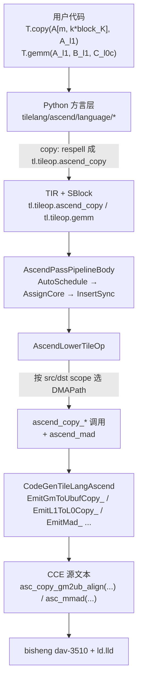

# 图 3：从方言 op 到 CCE intrinsic 的链路

来源：`_vendor/tilelang-v0.1.15/tilelang/ascend/language/copy_op.py:230-372`
（`copy` 把 `tl.tileop.copy` 改写成 `tl.tileop.ascend_copy`）、
`src/ascend/op/copy.cc`（按 `DMAPath` 分支生成 `ascend_copy_*` 调用）、
`src/ascend/codegen/codegen_ascend.cc:1383-1690`（每个 intrinsic 的最终文本）。
图为**本书绘制**。

## Mermaid



## ASCII

```text
T.copy / T.gemm（方言 op）
   │  copy_op.py 把 tl.tileop.copy 重拼成 tl.tileop.ascend_copy
   ▼
tl.tileop.ascend_copy                          ← AutoSchedule/InsertSync 在这里插同步
   │  AscendLowerTileOp：看 src/dst 的 scope
   ▼
DMAPath::kGMToL1 等（7 条搬运 + SF 两条）
   │  copy.cc 组装 ascend_copy_* / ascend_mad 的实参
   ▼
codegen_ascend.cc 的 Emit*_ 函数
   │  按名换成 CCE 内置函数
   ▼
asc_copy_gm2l1_nd2nz / asc_copy_l12l0a / asc_mmad / asc_copy_l0c2ub ...
   │
   ▼
bisheng --npu-arch=dav-3510   →   可执行 CCE ELF
```

要点：**同步不是用户写的**，并且在 IR 里先于 intrinsic 产生。`InsertSync` 在
`LowerScheduledTIR` 之前运行（`tilelang/ascend/pipeline.py:113-115`），
它插入的是 `hard_event`（`MTE2_FIX` 这类 pipe 对），
`RewriteFlagToBuf` 再把它落到 8 槽 flag 命名空间（`pipeline.py:176-182`）。
