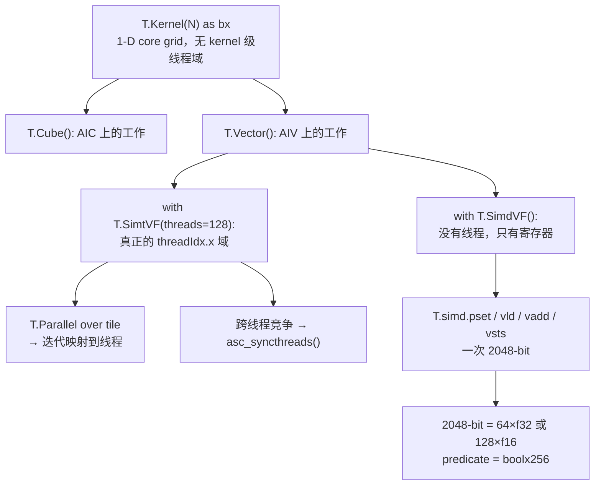

# 图 4：`SimtVF` / `SimdVF` 两个区域与 2048-bit 寄存器约束

来源：`_vendor/tilelang-v0.1.15/src/ascend/transform/vf_regions.h:19-60`
（`SIMT_VF` / `SIMD_VF` 是不透明 SBlock；`SIMT_VF` 自带 `threadIdx.x` 域）、
`src/ascend/codegen/codegen_ascend.cc:408-434`（SimdVF 必须是 2048-bit 寄存器，
predicate 必须是 `boolx256`）、`tilelang/ascend/language/frame.py:81-196`
（两个 frame 的 Python 定义）。图为**本书绘制**。

## Mermaid



## ASCII

```text
with T.Kernel(N) as bx:                ← 只有一维核网格，没有 threads=
    with T.SimtVF(threads=128):        ┐ SIMT_VF：内部开一个 threadIdx.x 域
        for i in T.Parallel(tile): ...  ┘ T.Parallel 把 tile 迭代分到线程
    with T.SimdVF():                   ┐ SIMD_VF：没有线程，寄存器级
        mask = T.simd.pset(32)          │ 一条指令吃一整个 2048-bit 寄存器
        v = T.simd.vadd(a, b, mask)     ┘

约束（codegen_ascend.cc:408-434）：
  SimdVF 里的向量类型必须恰好 2048 bit
  （f32×64 / f16×128 / bf16×128 / f8×256），否则 LOG(FATAL)
  predicate 必须是 boolx256，否则 LOG(FATAL)
```

两个区域都接受 `latency=` 作为**调度模型输入**（`frame.py:107-142,179-196`）；
它不填时由编译器估算，**不是实测周期**。
