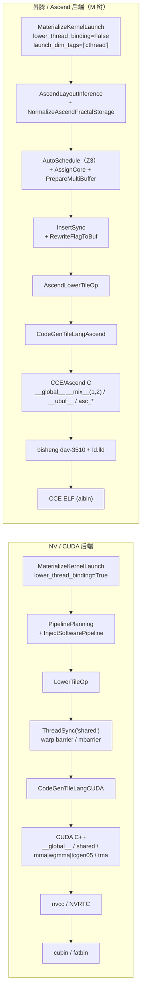

# 图 5：NV 与昇腾后端的结构对照

来源（NV 侧）：`_vendor/tilelang-v0.1.15/tilelang/cuda/backend.py:69-120`、
`tilelang/cuda/pipeline.py:69-279`、`tilelang/contrib/nvcc.py`。
来源（昇腾侧）：`tilelang/ascend/pipeline.py:36-190`、
`tilelang/ascend/backend.py:15-62`、`tilelang/contrib/bisheng.py:88-228`。
图为**本书绘制**；它只列**结构性事实**（谁生成什么、谁编译、同步插在哪个 pass），
不比较性能。

## Mermaid



## ASCII 对照表

```text
                NV / CUDA                          Ascend (M tree, v0.1.15)
--------------- ---------------------------------- -----------------------------------------
执行单元        SM (SIMT, warp=32 lane)           AIC(Cube) + AIV(Vector)，物理 1:2 group
线程模型        thread/block/warp                 核内无线程；T.SimtVF 内部才有 threadIdx
片上存储        shared memory / registers         L1 / L0A / L0B / L0C / UB
矩阵指令        mma / wgmma / tcgen05              asc_mmad（MAD），L0A×L0B→L0C
搬运            cp.async / TMA                     asc_copy_gm2l1_* / _ub2gm / _l12l0*
收尾            epilogue 在 register             Fixpipe：asc_copy_l0c2ub / _l0c2gm
流水/多缓冲     PipelinePlanning+InjectSWPipeline  AutoSchedule(Z3)+MaterializeMultiBuffer
同步            ThreadSync（warp barrier/mbarrier）InsertSync → hard_event → 8-slot flag
生成物          CUDA C++                            CCE/Ascend C（asc_* 风格）
编译器          nvcc / NVRTC                        bisheng（+ ld.lld 链接）
产物            cubin / fatbin                      linked CCE ELF (aibin)
```

一句话总结：**NV 的“一个线程块一组线程、共享内存 + 寄存器”模型，在昇腾被拆成
“Cube 核 + 两个 Vector 子核 + 五个片上 buffer + 四条搬运/收尾流水线”**；
这是两侧 codegen 与同步 pass 完全不同的根因。
