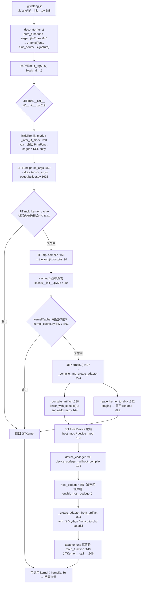

# 图 1：从 Python 到可调用对象

## Mermaid 版



## ASCII 版（每跳都是“入口函数 + 文件:行号”）

```text
① 装饰          @tilelang.jit                       tilelang/jit/__init__.py:588
                   └─ decorator()                    :638
                        prim_func(func, eager_jit=True)      :640
                        → JITImpl(func, func_source, signature)  :644

② 取 TIR        JITImpl.get_tir                      tilelang/jit/__init__.py:379
                   └─ func(*args, **kwargs) → PrimFunc
                   （前端在 eager 模式下走 Builder 追踪，
                     lazy 模式直接调用返回 PrimFunc）

③ 缓存查询      JITImpl.__call__                     tilelang/jit/__init__.py:519
                   ├─ 进程内：self._kernel_cache[key]        :551
                   └─ 磁盘/内存：cached(...)                 :164
                        └─ KernelCache.cached               tilelang/cache/kernel_cache.py:286
                             ├─ 内存 _memory_cache 检查      :376
                             ├─ 磁盘 _load_kernel_from_disk  :395 / :641
                             └─ 未命中才编译                  :427

④ lower         JITKernel._compile_artifact           tilelang/jit/kernel.py:288
                   └─ lower_with_context(...)         tilelang/engine/lower.py:144
                        ├─ PreLowerSemanticCheck      engine/semantic_check.py:21
                        ├─ context.lower(mod)   ← 后端分岔  engine/lower.py:136
                        └─ Filter 出 host/device 两个 IR  engine/lower.py:138

⑤ codegen       device_codegen / device_codegen_without_compile
                                                     tilelang/engine/lower.py:99 / :104
                host_codegen（按 execution backend 决定是否调用）  :65

⑥ adapter       JITKernel._create_adapter_from_artifact  tilelang/jit/kernel.py:324
                   ├─ tvm_ffi  → TVMFFIKernelAdapter        :342
                   ├─ cython   → CythonKernelAdapter        :360
                   ├─ nvrtc    → NVRTCKernelAdapter         :374
                   ├─ torch    → MetalKernelAdapter         :390（只接 Metal）
                   └─ cutedsl  → CuTeDSLKernelAdapter       :405

⑦ 可调用        JITKernel.torch_function = adapter.func  tilelang/jit/kernel.py:149
                JITKernel.__call__ 转发                  :206
```

## 读图要点

* **③ 和 ⑥ 之间夹着 ④⑤**：缓存命中时 ④⑤ 完全不执行，你拿到的是上一轮落盘的
  `kernel_lib.so`（`tilelang/cache/kernel_cache.py:641-731`）；缓存未命中才走完整条链。
* **②→③ 的顺序不能颠倒**：`lower` 需要的是 `PrimFunc`，而 `PrimFunc` 来自
  `get_tir`；缓存 key 又建立在 `func.script()` 上（`kernel_cache.py:269`），
  所以“先取 TIR、再算 key”是设计上必须的顺序。
* **⑦ 只有一个出口**：不管后端是哪一个，`JITKernel` 对外的调用面都是
  `adapter.func`。所有“框架集成”的差异都收敛在第 ⑥ 步。
