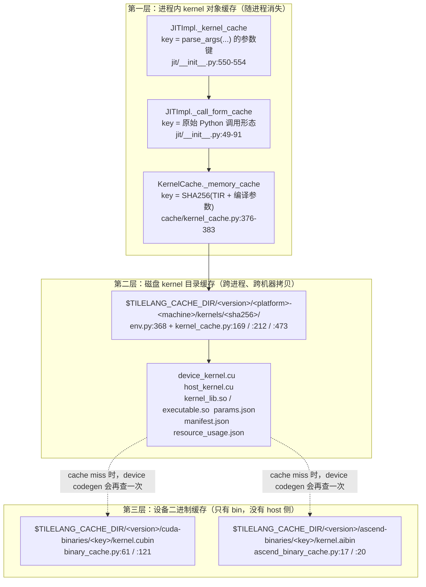

# 图 2：三本缓存账

v0.1.15 里「缓存」不是一个东西，而是三层互不相同、失效条件也不同的账。

## Mermaid 版

## 三层各自的 key 与失效条件

| 层 | key 由什么组成 | 什么时候失效 | 源码 |
| --- | --- | --- | --- |
| ① 进程内 `JITImpl._kernel_cache` | `JITFunc.parse_args()` 返回的 `(p1_key, p2_key)`：phase-1 是编译期参数（`M`/`N`/`block_M`…），phase-2 是张量实参引入的动态形状 | 进程退出即消失；同一进程内参数变了就换 key | `tilelang/jit/__init__.py:550-554`、`tilelang/language/eager/builder.py:1692-1705` |
| ① 进程内 `KernelCache._memory_cache` | 与 ② 同一把 key（`_generate_key`） | 进程退出即消失；`clear_cache()` 或 `KernelCache()` 重建目录时清掉 | `tilelang/cache/kernel_cache.py:376-383`、`:455-461` |
| ② 磁盘 kernel 目录 | `sha256(json({func.script(show_meta=True) 的 sha256, out_idx, args_repr, target, target_host, execution_backend, pass_configs, compile_flags, version, platform[, tilelang_lib][, torch]}))` | 上面任一字段变化；manifest 校验失败时整条目录被删除并重编 | `tilelang/cache/kernel_cache.py:243-284`、`:140-150`、`:807-835` |
| ③ 设备二进制 | `sha256(json({tilelang_version, code_hash, target_kind, target_arch, target_code/target_arch, compile_format, options[, linker_options]}))` | 上面任一字段变化。**device 源码变了但 host 源码没变时，只有这一层会失效** | `tilelang/cache/cuda_binary_cache.py:22-45`、`tilelang/cache/ascend_binary_cache.py:23-42`、`tilelang/cache/binary_cache.py:112-118` |

## 三条容易记错的推论

1. **改注释、改空白不会失效**。key 用的是 `func.script()`（TIR 文本），
   不是 Python 源码（`kernel_cache.py:269`）。
2. **改 C++ pass 默认不会失效**。`base["tilelang_lib"]` 只有在
   `TILELANG_KERNEL_CACHE_USE_LIB_STAMP=1` 时才进 key（`env.py:447-448`、
   `kernel_cache.py:142-145`）。这是「改了 pass 不生效」的头号原因。
3. **③ 是 ② 的「下半截」**。device codegen 结束时会调用后端的编译回调
   （CUDA：`src/cuda/codegen/rt_mod_cuda.cc:126-140` 调
   `tilelang_callback_cuda_compile`），回调里先查 ③
   （`tilelang/cuda/backend.py:106-120`），查不到才真正调 `nvcc` / `bisheng`。
   所以 ② 命中时根本不会走到 ③；**③ 只在 ② 未命中、但设备源码与上一轮完全相同时
   才发挥作用**——典型场景是多机共享同一份
   `$TILELANG_CACHE_DIR/<version>/{cuda,ascend}-binaries/`，而 host 侧
   `kernels/` 各自独立。这也解释了为什么 ③ 的 key 里刻意不含 `out_idx`、
   `pass_configs`、`execution_backend` 这些只影响 host 侧的字段。
