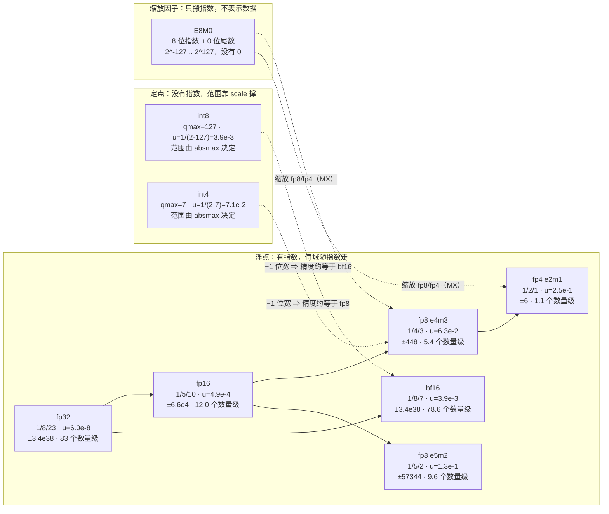

# 图 1：低精度格式阶梯

用于正文第 2.1–2.2 节。数字全部由 `code/01-number-formats/number_formats.py`
枚举位模式算出（**CPU 逻辑验证**），不是从别处抄的；`u = 2^-p`，
动态范围按“最大有限值 / 最小次正规数”取以 10 为底的对数。



## ASCII 版（便于复制粘贴与 diff）

```text
格式        布局     有效位 p   u = 2^-p   max 有限值   min 规格化数   动态范围(10^x)  相对精度对标
fp32        1/8/23   24        6.0e-08    3.4e+38      1.2e-38        83.0           —
fp16        1/5/10   11        4.9e-04    6.55e+04     6.1e-05        12.0           —
bf16        1/8/7    8         3.9e-03    3.39e+38     1.2e-38        78.6           int8 (3.9e-3)
fp8 e4m3    1/4/3    4         6.3e-02    448          0.0156         5.4            int4 (7.1e-2)
fp8 e5m2    1/5/2    3         1.3e-01    5.73e+04     6.1e-05        9.6            —
fp4 e2m1    1/2/1    2         2.5e-01    6            1              1.1            —
E8M0        8 位指数  —         0（精确）  1.70e+38     5.9e-39        76.5           scale 专用
```

## 三条读图结论

1. **动态范围与相对精度是两个独立维度**。bf16 的相对精度（3.9e-3）与 int8 相当，
   动态范围（78.6 个数量级）与 fp32 相当；e4m3 的动态范围只有 5.4 个数量级，
   所以它必须配一个 E8M0 scale 才能覆盖真实数据。
2. **fp8 的两种格式是一个显式的取舍**：e4m3 用范围换精度（前向、权重），
   e5m2 用精度换范围（反向、梯度）。差一个指数位，精度差一倍。
3. **int4 与 fp8 e4m3 的相对精度同级**（7.1e-2 对 6.3e-2），但 int4 没有指数，
   离群值会把整个 scale 拉大，所以 int4 更需要细粒度的 scale（per-group、
   甚至 per-channel + group 的混合）。

## 来源

* 所有数字：`code/01-number-formats/number_formats.py`（本仓库，CPU 逻辑验证）。
* 位布局定义：`../tilelang-corpus/05-nvidia-backend/raw/nvidia-ptx-isa.md:1196-1252`。
* 对标的工程结论（int8≈bf16、int4≈fp8）：
  `code/02-quant-dequant/quant_dequant.py` 与 `code/03-error-model/error_model.py`。
