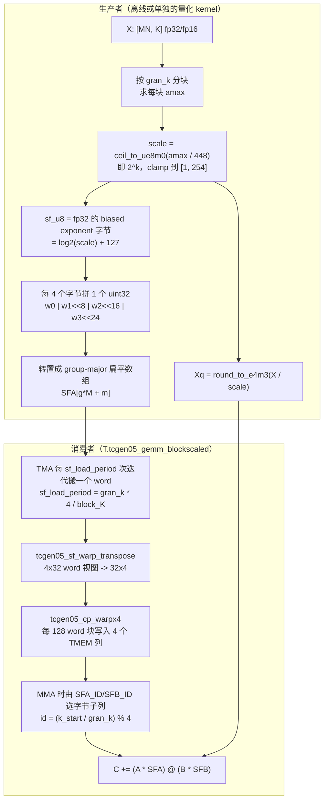

# 图 2：MX 块缩放（block-scaled）的生产与消费

用于正文第 2.3 节与第 4.1 节。左边是量化（生产 scale），右边是 kernel（消费
scale）。两边必须共享同一个粒度与同一个打包约定，否则结果直接错。



## ASCII 版

```text
生产者                                          消费者
─────────────────────────────────────────      ─────────────────────────────────────────
X[MN, K] fp16                                  SFA: [ceil(ceil(K/gran)/4) * M] uint32
  │ 按 gran 分块求 amax                          │ 每 sf_load_period = gran*4/block_K 次迭代搬 1 个 word
  ▼                                             ▼
scale = 2^ceil(log2(amax/448))                 tcgen05_sf_warp_transpose（4x32 -> 32x4）
  │                                             ▼
  ├─► Xq = round_e4m3(X / scale) ──► A/B tile   tcgen05_cp_warpx4（128 word -> 4 个 TMEM 列）
  │                                             ▼
  └─► sf_u8 = 指数字节 = log2(scale)+127        SFA_ID = (k_start/gran) % 4 选子列
        │                                       ▼
        └─► word = b0 | b1<<8 | b2<<16 | b3<<24  C += (A*SFA) @ (B*SFB)
            再按 group-major 展平：SFA[g*M+m]
```

## 三个必须写进接口的量

| 量 | 含义 | 锁定版本里的取值 |
| --- | --- | --- |
| `sf_granularity_k` | 一个 scale 字节覆盖多少个 K 元素 | SM100 MXFP8 示例是 128；PTX/CATLASS 的原生 MX block 是 32 |
| 一个 word 覆盖的 K | `4 × sf_granularity_k` | 128 粒度时是 512 |
| `sf_load_period` | 每多少次 K 迭代搬一个 word | `sf_granularity_k * 4 // block_K`；`block_K=128` 时是 4 |

## 来源

* `_vendor/tilelang-v0.1.15/examples/blockscaled_gemm_sm100/gemm_mxfp8_blockscaled_1d1d.py:1-73,509-572`
* `_vendor/tilelang-v0.1.15/examples/blockscaled_gemm_sm100/mxfp8_illustrated.md`（Scale-Factor Layout 一节）
* `_vendor/tilelang-v0.1.15/tilelang/language/builtin.py:1440-1479`
* `../tilelang-corpus/05-nvidia-backend/raw/nvidia-ptx-isa.md:32061-32240`
